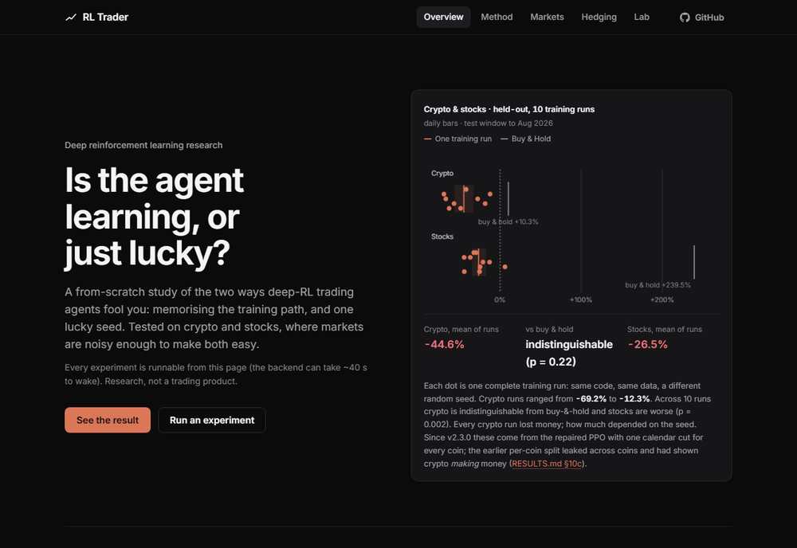

# RL Trader

**Is a deep-RL trading agent learning, or just lucky?** A from-scratch PPO study of
the two ways reinforcement-learning results fool you, memorising the training data
and one lucky seed, with markets as the testbed and an honest negative result.

[](https://github.com/Danny-397/RL-for-Crypto-and-stocks-/actions/workflows/ci.yml)
[](https://github.com/Danny-397/RL-for-Crypto-and-stocks-/actions/workflows/smoke.yml)
[](https://www.python.org/)
[](https://pytorch.org/)
[](LICENSE)
[](https://doi.org/10.5281/zenodo.23843503)

**[Live site and lab](https://rl-for-crypto-and-stocks.vercel.app/)** · [Results](RESULTS.md) · [Paper](paper/) ·
[Guide](guide/README.md) · [Cite](#citing)

[](https://rl-for-crypto-and-stocks.vercel.app/#lab)

<sub>Recorded by `tools/make_demo.py`, which drives the real page in headless
Chromium against a running backend. Every number in it was computed during the
capture.</sub>

## In brief

- **No edge.** Trained on ten real stocks and six coins and scored on history it never
  saw, across ten seeds, the agent loses to buy-and-hold on stocks (p = 0.002). On
  crypto every seed loses money; against buy-and-hold the verdict is borderline
  (p = 0.22 in the published run, 0.03 when replicated on other hardware). Adjusted
  for risk, its Sharpe ratio and its alpha on the traded asset are negative in both
  markets.
- **The study was audited, and it held.** A pre-registered audit found two real
  flaws: the PPO trailed Stable-Baselines3, and the crypto split leaked across coins.
  Both are fixed in v2.3.0, and neither changes the conclusion.
- **Where RL does help.** The same PPO, used to hedge a sold option instead of
  predicting prices, learns to trade less as costs rise and beats a tuned textbook
  hedge at high costs on 19 years of real SPY data.

The finding is negative, and that is the contribution: the point of the project is the
evaluation machinery that establishes it.

## What this is, and what it is not

|  |  |
|---|---|
| **What it is** | A reinforcement-learning research study: does one PPO recipe generalize across market regimes, and does an apparent edge survive proper testing? The experiments ship with it and run in the browser. |
| **What it is not** | Not a trading bot, a signal service, or investment advice. It places no orders, connects to no broker or exchange, and holds no money. |
| **Is it real-time?** | No. Daily closing bars, never intraday or streaming. Every published figure is a fixed snapshot, with the window pinned in [`data/SNAPSHOT.json`](data/SNAPSHOT.json); the agent never retrains on new data. |
| **What is live** | The lab's out-of-distribution test downloads fresh daily bars for a ticker you type and runs the same frozen policy over them. |

## The result

The same PPO recipe, trained on ten real stocks and six coins and scored on held-out
history it never saw, across ten training seeds:

<!-- BEGIN GENERATED: significance-brief -->
| Market | Agent return (95% CI, seeds) | Buy & hold | Verdict |
|---|---:|---:|---|
| Crypto | **−44.6%** `[−56%, −33%]` | +10% | indistinguishable (p = 0.22) |
| Stock | **−26.5%** `[−35%, −17%]` | +240% | significantly **worse** (p = 0.0021) |
<!-- END GENERATED: significance-brief -->

Two supervised models on the same features do no better than buy-and-hold, and on
stocks, shuffling the price history to destroy any structure does not change the
agent's result (the crypto test is inconclusive). The market, not the algorithm, is
the bottleneck. An earlier build published a +275% crypto run (commit `d4c0ef9`); the
multi-seed tests are what showed it was luck. Full methodology in
[RESULTS.md](RESULTS.md), and a longer tour in [guide/findings.md](guide/findings.md).

## Does it hold up?

A negative result is only as good as the machinery behind it, so the study was put
through the checks a reviewer applying current deep-RL evaluation practice would ask
for, each **pre-registered** before it ran
([registration](docs/preregistration/2026-11-13-rigor.md),
[outcomes](docs/preregistration/2026-11-13-rigor.results.md),
[RESULTS §10](RESULTS.md)). It found two real flaws and reports both:

- **The PPO was not fully correct.** Against Stable-Baselines3 under identical
  hyper-parameters it trailed on HalfCheetah and Pendulum. Seven standard
  implementation details, together, close the gap on HalfCheetah, Hopper and
  InvertedPendulum; Pendulum stays unexplained. The repairs are the defaults from
  v2.3.0, and `RL_TRADER_PUBLISHED=1` restores the published PPO and split, so every
  v2.2.1 number still reproduces.
- **The crypto split leaked.** Coins were cut 60/40 on their own histories, so some
  were trained on dates that were already test dates for others. That inflated every
  published crypto number; stocks were unaffected.

Two further checks came later. Re-running the published seeds on a different
machine leaves the stock verdict unchanged and moves the crypto one across the 0.05
line, because individual seeds diverge across hardware and six coins give the test
little margin. And adjusting for risk (Sharpe ratio; alpha and beta on the traded
asset) makes the agent look worse, not better ([RESULTS §5d–5e](RESULTS.md)):

<!-- BEGIN GENERATED: significance-risk -->
| Market | Sharpe, agent | Sharpe, buy & hold | Sharpe test | Alpha on the traded asset (95% CI, seeds) | Alpha test | Beta |
|---|---:|---:|---|---:|---|---:|
| Stock | −0.53 | +1.12 | **lower** (p = 0.0021) | **−12.6%** a year `[−14.8%, −10.2%]` | **negative** (p = 0.0021) | +0.14 |
| Crypto | −0.61 | +0.32 | **lower** (p = 0.03) | **−32.2%** a year `[−49.9%, −16.8%]` | **negative** (p = 0.03) | +0.00 |

*From the replication run (same seeds, data and held-out windows as the published study; RESULTS.md §5d). Sharpe is annualised from daily returns; the test is the same paired permutation across tickers. Alpha and beta come from regressing the agent's daily returns on the traded asset's (zero risk-free rate); alpha is annualised, and its test is a sign-flip test of the per-ticker alphas against zero.*
<!-- END GENERATED: significance-risk -->

Neither the audit nor these checks change the conclusion. Held-out return at the
published budget, mean basket return (IQM over 10 seeds):

<!-- BEGIN GENERATED: rigor-implementations -->
| Market | Buy & hold | PPO as published | PPO repaired | SB3 PPO | SB3 SAC |
|---|---:|---:|---:|---:|---:|
| Stocks | +239.5% | −22.8% (p = 0.0021) | −29.8% (p = 0.0021) | −18.4% (p = 0.0021) | −25.1% (p = 0.0021) |
| Crypto, per-coin cut (as published; leaks) | +33.5% | +13.2% (p = 0.66) | – | +27.8% (p = 0.85) | +224.3% (p = 0.47) |
| Crypto, one calendar cut (leak-free) | +10.3% | −29.1% (p = 0.50) | −38.4% (p = 0.31) | −63.5% (p = 0.03) | −30.2% (p = 0.22) |

*Basket-mean held-out return at 150k steps (the published budget), IQM over seeds 200–209; p from a paired permutation test of agent vs. buy-and-hold across the held-out tickers (10 stocks, 6 coins). Same archived data (2026-10-28 snapshot) and 60/40 split as the pre-registered replication.*
<!-- END GENERATED: rigor-implementations -->

The same holds at every budget from 25k to 1M steps, and on a stock universe chosen
without hindsight (the Dow 30 of 2016), where buy-and-hold falls from +240% to +101%
and the agent still loses to it. Of the 14 p-values the paper reports, every claim of
a difference survives Holm–Bonferroni within its question; two (hedging at 0.2% cost,
the crypto surrogate control) do not survive one family of all fourteen.

## Part 2: where RL does help

Predicting prices is a forecasting problem, and PPO adds nothing to it. Hedging is a
decision problem: you have sold an option and each day choose how many shares to hold
against it, when every trade costs money. Theory gives two answers the agent must
reproduce (with free trading, the Black-Scholes delta; with costs, a no-trade band
around it), and beyond those the best policy is not known in closed form. The same
PPO, trained only on simulated prices, is checked against both and then tested on 237
real one-month SPY episodes (2007–2026) it never saw, against delta with a no-trade
band tuned per cost:

<!-- BEGIN GENERATED: hedging-real -->
| Trading cost | RL agent (median of 10) | Seed range | Delta daily | Tuned band | No hedge | P&L spread agent / band | Worst 5% agent / band | Seeds beating band |
|---|---:|---:|---:|---:|---:|---:|---:|---:|
| none | -0.107 | -0.142 to -0.082 | -0.100 | -0.100 (±0) | -3.416 | 0.64% / 0.69% | 1.56% / 1.94% | 4/10 (p = 0.32) |
| 0.05% | -0.207 | -0.280 to -0.186 | -0.224 | -0.216 (±0.01) | -3.416 | 0.62% / 0.67% | 1.59% / 1.99% | 7/10 (p = 0.80) |
| 0.2% | -0.506 | -0.565 to -0.471 | -0.611 | -0.547 (±0.03) | -3.416 | 0.65% / 0.65% | 1.84% / 2.21% | 9/10 (p = 0.0057) |
| 1% | -1.776 | -1.827 to -1.660 | -3.122 | -2.355 (±0.1) | -3.416 | 0.90% / 0.69% | 3.10% / 3.25% | 10/10 (p = 0.0021) |

*237 non-overlapping one-month episodes, 2007-01 to 2026-09; SPY daily closes (dividend-adjusted, Yahoo); implied volatility 0.875 x VIX (Cboe). No policy or band saw these prices.*
<!-- END GENERATED: hedging-real -->

It rediscovers delta approximately (within about 0.04 shares, but scoring below it),
learns to trade less as costs rise, ties the tuned band at low costs and beats it at
high costs on real data. Write-up in
[RESULTS.md §9](RESULTS.md#9-part-2--where-rl-helps-hedging-an-option-with-trading-costs),
and an interactive version on the [site](https://rl-for-crypto-and-stocks.vercel.app/#hedging). A check against real SPY
option quotes ([RESULTS.md §9b](RESULTS.md#9b-on-real-option-quotes)) finds the
model's volatility assumption close, and fills in full episodes on real quotes week by
week as the quote archive grows.

## How it is built

- **PPO from scratch in PyTorch**, benchmarked against Stable-Baselines3 on four
  standard control tasks ([RESULTS.md §10a](RESULTS.md#10a-is-the-ppo-correct)).
- **Gymnasium environments** for stocks and crypto (28 features, a 563-dimensional
  observation, costs and slippage), a portfolio allocator, and the option-hedging
  environment of Part 2.
- **An evaluation suite built for few-seed RL**: bootstrap CIs, paired permutation
  tests, a surrogate-data falsification test with a positive control, Holm
  corrections, the interquartile mean, and pre-registered replications.
- **A live lab** ([guide/lab.md](guide/lab.md)) on a Flask backend that serves the
  policy as NumPy, tested in CI by 144 headless-browser checks.
- **Generated documentation.** Every result table in this README, RESULTS.md and the
  paper is rebuilt from committed artifacts by `tools/sync_docs.py`, and the test
  suite fails if any of them drifts.

```
rl_trader/     the package: PPO, environments, data pipeline, evaluation, hedging
server/        Flask API behind the lab (NumPy inference, no PyTorch)
docs/          the website (static, deployed on Vercel) and its data files
tools/         experiment, figure and site-data scripts
tests/         pytest suite, including the checks that keep the docs honest
paper/         the paper: LaTeX source, PDF and figures
guide/         longer documentation
```

Design decisions: [guide/architecture.md](guide/architecture.md).

## Quick start

```bash
pip install -e .                       # the package and training stack (PyTorch)
python tools/fetch_data.py             # download the real basket (Yahoo, daily closes)
python tools/real_significance.py --seeds 10 --timesteps 150000   # the headline study
pytest -q                              # the test suite
```

`requirements.txt` is the lighter, PyTorch-free set the backend needs to serve the
policy. Using your own data and pinning the dataset: [guide/usage.md](guide/usage.md).
`RL_TRADER_PUBLISHED=1` reproduces the v2.2.1 numbers exactly.

## Read more

| | |
|---|---|
| [RESULTS.md](RESULTS.md) | Every experiment, its method and its numbers |
| [paper/](paper/) | The paper (arXiv-style PDF and source) |
| [guide/](guide/README.md) | Findings tour, background, the lab and API, architecture, usage |
| [docs/preregistration/](docs/preregistration/) | Predictions registered before their runs, and how they came out |
| [DEPLOY.md](DEPLOY.md) | How the site and backend are deployed |

## Citing

The code and paper are archived on Zenodo. Cite
[10.5281/zenodo.23843503](https://doi.org/10.5281/zenodo.23843503), which always
resolves to the newest version. GitHub's "Cite this repository" button reads the same
details from [CITATION.cff](CITATION.cff).

## License

MIT. See [LICENSE](LICENSE).
