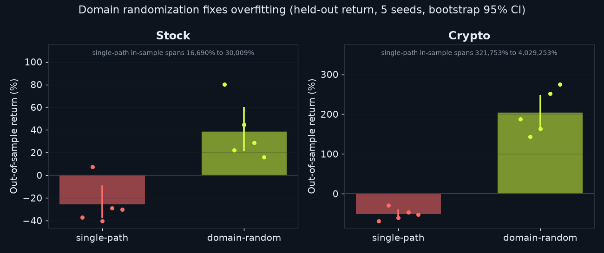
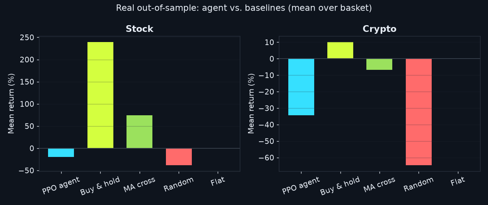
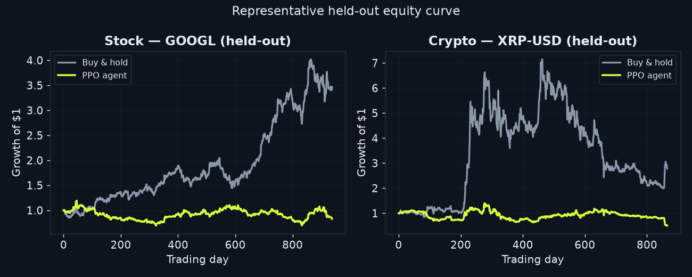

# Results & Findings

An empirical study of **generalization and evaluation rigor in deep reinforcement
learning**, using financial markets as a hard, non-stationary testbed. This is the
honest write-up — including (especially) the parts that *don't* work, because the
negative result is the scientifically interesting one. Every number reproduces with
the commands in the final section.

The three research questions (RQ1 regime transfer, RQ2 overfitting/domain
randomization, RQ3 does an edge survive multi-seed testing) map to §3, §1, and §5
respectively.

---

## TL;DR

1. **The method is sound where signal exists (RQ1/RQ2).** On controlled synthetic
   markets with known structure, the agent learns a profitable, *generalizing*
   policy — and an ablation proves that **domain randomization is what makes it
   generalize**: across 10 seeds it flips held-out return from reliably negative to
   reliably positive — **all four bootstrap CIs exclude zero**, in both markets.
   This is the same lesson as Tobin et al. (2017) and Cobbe et al. (2019),
   reproduced from scratch.
2. **A single seed can *look* like a real-market win — and that's the trap.** An
   earlier build of this study (commit `d4c0ef9`) published the crypto agent at
   **+275% against buy-&-hold's +19%**, winning 4 of 6 coins. Taken alone, that is a
   tempting headline. It was not one: it survived neither reseeding (§5) nor moving
   the evaluation window forward by two months (§4).
3. **Multi-seed evaluation dissolves the illusion (RQ3).** Across **10 seeds** the
   agent is significantly **worse** than buy-and-hold on equities and loses money on
   crypto in every seed; in the v2.2.1 build, whose crypto split leaked (§10c), the
   crypto seeds ranged from more than tripling capital to losing it. There is **no
   reliable, seed-robust edge on real markets** — consistent with weak-form market
   efficiency (Fama, 1970), even with the cross-asset features. The numbers are in
   §5.
4. **Catching that is the result.** This is Henderson et al.'s (2018) *Deep RL that
   Matters* finding — single-run RL numbers are unreliable — reproduced in a new
   domain: the framework's own significance tooling exposed a false positive that a
   naive project would have shipped as a win. The contribution is the **rigorous,
   honest methodology**, not a fantasy return.
5. **Then the study was put through the same scrutiny (§10).** Pre-registered
   checks against current deep-RL evaluation practice found two real flaws: the
   from-scratch PPO trailed Stable-Baselines3 on two of four standard benchmarks
   (seven implementation details close the gap on three of the four), and the
   crypto split leaked across coins in calendar time, inflating every published
   crypto number. Neither changes the conclusion. With the repaired PPO, with
   Stable-Baselines3's PPO and SAC, at budgets up to 1M steps, on a leak-free crypto
   split and on a hindsight-free stock universe, no agent beats buy-and-hold.

The point of the project is the **methodology and the honest evaluation**, not a
fantasy money-machine.

---

## Setup

| | |
|---|---|
| **Algorithm** | PPO implemented from scratch in PyTorch (clipped objective, GAE, entropy bonus, orthogonal init, grad clipping) — plus a fully-implemented **recurrent (LSTM) PPO** variant (truncated BPTT) |
| **Environments** | Custom Gymnasium `StockTradingEnv` / `CryptoTradingEnv` over a shared base; continuous target-position actions in `[-1, 1]`; transaction costs + slippage |
| **Features** | **28 engineered, stationary features** per bar — multi-horizon momentum (1–120 bar), MA/EMA ratios, RSI, MACD, Bollinger %B, Donchian position, ATR, volatility-regime signals, distance-below-trailing-high, volume microstructure, and **cross-asset context** (relative strength vs. SPY/BTC + market trend/momentum) — over a rolling window |
| **Reward** | Selectable: risk-aware net return (return − drawdown − turnover) **or** the **Differential Sharpe Ratio** (Moody & Saffell, 1998) |
| **Training** | Running (Welford) observation normalisation, exported and applied at serve time; fully seeded (Torch + NumPy + env RNG) so runs are reproducible |
| **Real data** | 10 equities + 6 crypto pairs, daily OHLCV, ~10 yrs (Yahoo Finance). **Frozen evaluation snapshot: data through 2026-08-28** (pinned in `data/SNAPSHOT.json`; §5c's walk-forward predates it and uses data through 2026-06-17) — deliberately fixed so every number below is reproducible; refresh with `tools/fetch_data.py` to re-snapshot to a later date |
| **Split** | Chronological walk-forward — train on the older 60%, test on the held-out recent 40%; scalers fit on training data only |
| **Reporting** | Mean across the basket; agent run deterministically; benchmarked vs. buy-&-hold, random, and a moving-average-crossover rule; uncertainty via bootstrap CIs + a permutation test |

---

## 1. Methodology validation — the domain-randomization ablation

Training an RL agent on a **single** price series is a trap: it memorises that
one path. To show this concretely, we train two otherwise-identical agents on
synthetic data (where a real, known signal exists) and measure performance on
the training path ("in-sample") vs. 30 unseen paths ("out-of-sample").

`python tools/ablation_multiseed.py --seeds 42 43 44 45 46 47 48 49 50 51 --timesteps 60000`

10 seeds, 60k steps. Out-of-sample is the mean over 30 held-out paths (identical for
every arm and seed) with a bootstrap 95% CI across seeds. In-sample is given as a
**range** over seeds, not a mean — it is one leveraged compounding return on a
memorized path and spans orders of magnitude.

<!-- BEGIN GENERATED: ablation-table -->
| Training setup | In-sample (range over seeds) | Held-out return (mean, 95% CI) |
|---|---:|---:|
| Stocks · single asset | +6k% to +31k% | **−25%** `[−33%, −15%]` |
| Stocks · across tickers | −22% to +59% | **+31%** `[+21%, +44%]` |
| Crypto · single asset | +87k% to +4.0M% | **−44%** `[−59%, −21%]` |
| Crypto · across tickers | +24% to +460% | **+187%** `[+147%, +229%]` |

*10 seeds × 60k steps, bootstrap 95% CI, held-out paths held identical across arms. In-sample is a range rather than a mean because it varies by an order of magnitude across seeds; quoting one run of it would imply a precision that is not there.*
<!-- END GENERATED: ablation-table -->



**Reading it:** the single-path agents post absurd in-sample returns by memorising
their training sequence, then **lose money** on unseen data. Domain randomization
(a fresh path every episode) is the single change that flips held-out return
positive — and across ten seeds every one of these four intervals excludes zero.

All four intervals exclude zero, so the effect is robust to seed choice — which is
precisely the property §5 shows real-market edges *lack*. Two caveats the
distribution makes visible and a single run would hide:

- **"Reliably negative" is a statement about the mean, not every seed.** In each
  market one of the ten single-path seeds finished positive out-of-sample (stocks
  +7.6%, crypto +47%), and a second stock seed finished flat (−0.2%). The intervals
  still exclude zero, but a reader quoting any single run could have drawn the
  opposite conclusion.
- **The domain-randomized arm is positive in all 20 runs** (stocks +11% to +80%,
  crypto +82% to +291%). No single seed carries the crypto mean; the spread is wide
  because crypto paths compound volatility, not because of one outlier.

**What multi-seed reporting actually changed.** The out-of-sample conclusion
survived; the in-sample column did not. Single-path in-sample ranges from +6,400%
to +31,000% on equities and from +87,000% to +4,000,000% on crypto across seeds —
quoting any one of those as *the* memorization figure, as an earlier version of
this table did, communicates a precision that does not exist. Worth noting for
honesty: at three seeds the equity single-path interval still straddled zero. The
five-seed count was fixed to match §2 before that arm was run; the later move to ten
applied to all four arms at once, and every interval excluded zero at both counts.

Two further notes on reproducibility:

- **Both arms are seeded.** The domain-randomized arm draws a fresh path every
  episode — that is what domain randomization means — but since v2.1 the stream of
  paths comes from `seeded_path_factory(market, seed)`, so a given seed reproduces
  its run exactly. (Before that it called `synthetic_market_data(market)` with no
  seed, and single runs of that arm could not be reproduced.)
- An earlier version of this table was **stale**: its numbers predate commit
  `d4c0ef9`, which took the observation space from 19 to 28 features, so they
  described a model this repository no longer ships. Regenerate from
  `docs/assets/ablation_multiseed.json`; do not transcribe cells by hand.

---

## 2. Is the edge real, or seed luck? — a multi-seed significance study

A single backtest is an anecdote. `tools/significance.py` trains **5 independent
seeds**, evaluates each on the **same 20 held-out synthetic paths**, and then
quantifies the result two ways: a bootstrap 95% confidence interval across seeds,
and a paired permutation test of the agent vs. buy-&-hold across paths.

`python tools/significance.py --market crypto --seeds 5 --timesteps 40000`

<!-- BEGIN GENERATED: significance-synth -->
| Market | Agent OOS return (95% CI) | Agent OOS Sharpe (95% CI) | Buy & hold | Agent − B&H | p-value |
|---|---:|---:|---:|---:|---:|
| Stock | +18.1% `[+10.0%, +27.0%]` | +0.35 `[+0.20, +0.50]` | +28.5% | −10.4% | 0.60 |
| Crypto | +96.6% `[+77.3%, +116.0%]` | +0.72 `[+0.60, +0.85]` | +66.7% | +29.9% | 0.57 |
<!-- END GENERATED: significance-synth -->

**Reading it:** the confidence intervals are *tight and positive* — the agent
reliably makes risk-adjusted money across seeds, not by luck. But the permutation
test says the difference from buy-&-hold is **not statistically significant**
(p ≫ 0.05). The honest conclusion: the agent learns a genuine, repeatable policy
that is *competitive with* — not provably better than — passive exposure on these
synthetic paths. That is exactly the discipline I apply to the real-data win below.

---

## 3. Real-market results — a single seed (out-of-sample, walk-forward)

`python tools/build_site_data.py --real` then `python tools/baseline_report.py`

> ⚠️ **Read this with §5.** The tables below are **one training seed (42)** — the
> run the dashboard displays. §5 shows what happens across many seeds. This
> single-seed table is shown for transparency, not as the headline result.

> **Updated in v2.3.0.** These numbers now come from the repaired PPO (§10a) with one calendar cut for every ticker (§10c), on the archived 2026-10-28 data snapshot. In v2.2.1, whose crypto split leaked, this run
> read crypto +38.7% and stock −4.7%; `RL_TRADER_PUBLISHED=1` restores that setup.

**The published run:**

<!-- BEGIN GENERATED: headline-run -->
Seed 42, 200,000 timesteps, test window ending 2026-08-28:

- **Crypto** — agent −34.4% vs. buy-and-hold +10.3%, beating buy-and-hold on 2 of 6 tickers (Sharpe −0.24, max drawdown 66.5%).
- **Stock** — agent −19.8% vs. buy-and-hold +239.5%, beating buy-and-hold on 0 of 10 tickers (Sharpe −0.27, max drawdown 43.8%).
<!-- END GENERATED: headline-run -->



<!-- BEGIN GENERATED: baselines-table -->
**Stocks** — mean over 10 held-out tickers (the agent beats buy-and-hold on 0 of 10):

| Strategy | Return | Sharpe | Max DD |
|---|---:|---:|---:|
| **PPO agent** | −19.8% | −0.27 | 43.8% |
| Buy & hold | +239.3% | +1.12 | 26.9% |
| MA crossover | +74.5% | +0.78 | 23.4% |
| Flat (cash) | +0.0% | +0.00 | 0.0% |
| Random | −37.8% | −0.98 | 51.9% |

**Crypto** — mean over 6 held-out tickers (the agent beats buy-and-hold on 2 of 6):

| Strategy | Return | Sharpe | Max DD |
|---|---:|---:|---:|
| **PPO agent** | −34.4% | −0.24 | 66.5% |
| Buy & hold | +10.1% | +0.32 | 71.3% |
| MA crossover | −6.8% | +0.04 | 56.8% |
| Flat (cash) | +0.0% | +0.00 | 0.0% |
| Random | −64.5% | −0.99 | 70.5% |
<!-- END GENERATED: baselines-table -->

*Buy-and-hold in these tables is traded through the same environment as the agent,
so it pays the same entry cost and slippage; the headline lines above use the
frictionless price return, which is why the two differ by a few tenths of a point
(+239.5% vs +239.3% on stocks, +10.3% vs +10.1% on crypto).*

---

A representative held-out equity curve for each market (the median-return ticker):



### 3b. Would a simpler model have done better?

The baselines above are all rule-based, so beating them shows only that the agent
is not useless. They cannot answer the objection a skeptical reader actually has:
**perhaps there is structure here and PPO is the wrong tool for finding it.**

So two ordinary supervised models were fit on the *same* 28 features over the
*same* training split — ridge regression on the next bar's return, logistic
regression on its direction — and traded through the *same* environment at the
*same* costs. Both are implemented from scratch in NumPy
(`rl_trader/evaluation/supervised.py`); neither sees a single bar of the test
period during fitting.

`python tools/supervised_report.py`

<!-- BEGIN GENERATED: supervised-table -->
**Stocks** — mean over 10 held-out tickers, ranked:

| Strategy | Return |
|---|---:|
| Buy & hold | +239.3% |
| MA crossover | +74.5% |
| Logistic direction *(learned)* | +3.1% |
| Flat (cash) | +0.0% |
| Ridge regression *(learned)* | −6.0% |
| **PPO agent** | −19.8% |
| Random | −37.8% |

*Logistic in-sample directional accuracy: 55.6%.*

**Crypto** — mean over 6 held-out tickers, ranked:

| Strategy | Return |
|---|---:|
| Buy & hold | +10.1% |
| Ridge regression *(learned)* | +0.1% |
| Flat (cash) | +0.0% |
| Logistic direction *(learned)* | −4.6% |
| MA crossover | −6.8% |
| **PPO agent** | −34.4% |
| Random | −64.5% |

*Logistic in-sample directional accuracy: 55.1%.*
<!-- END GENERATED: supervised-table -->

**Reading it:** neither supervised model beat buy-and-hold in either market, so
two unrelated method classes reach the same place. That is what one expects if
the features carry no exploitable structure, and not what one expects if the
problem were simply that PPO is bad at this. Two details are worth not glossing:
both supervised models beat the trained agent in both markets — the agent is not
even the best use of its own inputs — and in-sample directional accuracy
was **above** chance, so the models did fit their training data and none of it
survived into the held-out period. That is the domain-randomization result of §1
reached by a completely different route.

### 3c. How much of the loss is friction?

A strategy that is flat gross and negative net is a different animal from one
with no edge at all, and nothing above separates them. Because the policy is
frozen, it can simply be replayed at different cost levels.

`python tools/cost_sensitivity.py`

<!-- BEGIN GENERATED: cost-table -->
**Stocks**:

| Costs | Fee | Slippage | Mean held-out return | Turnover |
|---|---:|---:|---:|---:|
| 0× | 0.000% | 0.000% | +15.2% | 0.82 |
| 0.5× | 0.025% | 0.015% | −3.9% | 0.82 |
| 1× *(published)* | 0.050% | 0.030% | −19.8% | 0.82 |
| 2× | 0.100% | 0.060% | −44.2% | 0.82 |
| 5× | 0.250% | 0.150% | −79.2% | 0.82 |

**Crypto**:

| Costs | Fee | Slippage | Mean held-out return | Turnover |
|---|---:|---:|---:|---:|
| 0× | 0.000% | 0.000% | +66.5% | 0.84 |
| 0.5× | 0.050% | 0.050% | +4.0% | 0.84 |
| 1× *(published)* | 0.100% | 0.100% | −34.4% | 0.84 |
| 2× | 0.200% | 0.200% | −71.0% | 0.84 |
| 5× | 0.500% | 0.500% | −80.6% | 0.88 |

*Turnover is the mean absolute change in target position per bar: 0 would be buy-and-hold, 2.0 would be flipping fully long to fully short every bar. The policy is frozen and replayed — it is not retrained per cost level, which would measure churn rather than friction.*
<!-- END GENERATED: cost-table -->

**Reading it, carefully.** The agent is positive *before* friction in both
markets and negative after it in both, and its turnover is over **four-fifths of
its equity per bar** — that is the mechanism, and it is a real measurement.

It is *not* evidence of a tradable edge, and the temptation to read it that way
is exactly why it is written up here rather than left in a notebook. A
frictionless backtest is unattainable by construction: with cost and slippage at
zero, an agent can flip its position every bar for free and compound noise doing
it. These are single-seed runs. And it sits in tension with §6, which finds the
agent does no better on real price history than on the same returns shuffled — a
genuine directional edge should not survive that shuffle, whereas a mechanical
one would. What survives is narrower: **turnover, not signal, is the binding
constraint on this policy**, and a lower-turnover variant is the obvious next
experiment.


## 4. Discussion — why the single-seed table is misleading

- **A favorable draw is not a representative one.** The superseded build at commit
  `d4c0ef9` posted +275% on crypto and won 4 of 6 coins. Training is fully seeded, so
  that number *reproduces* — but reproducing a lucky seed does not make it typical.
  §5 re-runs the experiment across seeds and finds a spread wide enough that no
  single run carries information about the next one.
- **And the evaluation window mattered as much as the seed.** Rebuilding the
  identical recipe — same code, same seed 42, same 200k steps — against a snapshot
  pinned two months later moved that crypto headline from +275% to +38.7%, against
  a benchmark that had itself risen. Nothing about the model changed. (The figure
  in the table above is lower again: v2.3.0 uses a leak-free split, §10c.) The window is part of the claim, which is why `data/SNAPSHOT.json` pins
  it.
- **The equities single seed is already an honest loss.** Even on the displayed
  seed the stock agent loses against the mega-cap bull, and the hand-coded
  MA-crossover beats it — see the table above — a reminder that model complexity is
  not a virtue by itself. Across seeds (§5) it is significantly worse.
- **This is what weak-form market efficiency looks like.** Raw daily OHLCV carries
  little exploitable structure; an agent trading on it gets whipsawed and pays costs.
  Any single backtest is dominated by seed and split luck — which is exactly why a
  *distribution* (§5), not a point estimate (§3), is the honest unit of evidence.

## 5. Real-data significance — does the single-seed win survive?

This is the section that matters. `tools/real_significance.py` repeats the entire
real walk-forward across **10 independent seeds**, then reports a bootstrap 95% CI
on the basket-mean return *across seeds* and a paired permutation test of the agent
vs. buy-&-hold *across the held-out tickers*.

`python tools/real_significance.py --seeds 10 --timesteps 150000`

> **Updated in v2.3.0.** These numbers now come from the repaired PPO (§10a) with one calendar cut for every ticker (§10c), on the archived 2026-10-28 data snapshot. Seeds 100–109, 150k steps. The v2.2.1
> table (published PPO, per-coin cuts, August data) read: stock −19.1%
> [−26.7%, −11.2%], p = 0.0021; crypto +56.8% [+16.3%, +106.3%], p = 0.79.

<!-- BEGIN GENERATED: significance-full -->
| Market | Agent return (95% CI across seeds) | Buy & hold | Agent − B&H | p-value | Verdict |
|---|---:|---:|---:|---:|---|
| Stock | **−26.5%** `[−34.7%, −17.4%]` | +239.5% | −266.0% | **0.0021** | significantly **worse** than B&H |
| Crypto | **−44.6%** `[−56.2%, −32.7%]` | +10.3% | −54.9% | 0.22 | **indistinguishable** from B&H |

*10 independent training seeds per market. The p-value is a paired permutation test of agent vs. buy-and-hold across the held-out tickers (10 equities, 6 crypto pairs), not across seeds — the two axes answer different questions and their p-values are not comparable.*
<!-- END GENERATED: significance-full -->

**Reading it (28-feature model, incl. cross-asset features).** On **equities** the
agent is significantly *worse* than buy-and-hold — a clean negative result. On
**crypto** it loses money in every seed and its interval lies wholly below zero;
the paired test still cannot separate it from buy-and-hold, because buy-and-hold
itself made only +10% over the window and differed widely across coins. In v2.2.1
the crypto mean was *positive* with an interval above zero; that was partly seed
luck (the replication below said so) and partly the calendar leak (§10c).
Per-seed returns were:

<!-- BEGIN GENERATED: seed-spread -->
- **Stock** — −29.6%, −44.3%, −21.1%, −24.6%, −44.1%, −32.4%, −36.7%, −13.0%, +6.1%, −25.2%
- **Crypto** — −41.8%, −69.2%, −66.9%, −56.8%, −62.7%, −42.0%, −12.2%, −27.6%, −18.4%, −48.6%
<!-- END GENERATED: seed-spread -->

Seeds that spread this widely cannot support a claim about any one of them.
This study originally ran **5** seeds, at which the sign-flip test on the seed axis
could not reach p ≤ 0.05 even in principle — its floor is 2/2⁵ = 0.0625, which the
lab's power calculator reports for any design that small. It was rerun at **10**
seeds for exactly that reason, dropping the floor to 2/2¹⁰ = 0.002 and roughly
halving the width of the crypto interval. The conclusion did not change; the
ability of the test to have detected a change is what improved.
**There is no reliable, seed-robust edge on real markets**, even after adding
relative-strength and market-regime features. A naive project would have shipped the
§3 table as a win; the multi-seed test is what catches it.

**Pre-registered replication (2026-10-28).** Ten never-run seeds (200–209), same
recipe and budget, with the predictions committed before the run
([registration](docs/preregistration/2026-10-28-fresh-seeds.md),
[results](docs/preregistration/2026-10-28-fresh-seeds.results.md)). All four
predictions held: stock −19.8% vs +239.5% buy-and-hold, p = 0.0021; crypto
indistinguishable from buy-and-hold, p = 0.88. One detail above did **not**
replicate: the crypto mean fell to +26.7% and its interval, [−13.8%, +70.4%], now
includes zero, so "the agent made money on average across seeds" was itself
partly seed luck. (The replication used re-fetched data that Yahoo has since
re-adjusted, so data drift may contribute.) Both of these used the v2.2.1 PPO and
split. Under v2.3.0 the same seeds 200–209 give stock −23.4% (p = 0.0021) and
crypto −29.0% (p = 0.31), the same verdicts as the table above (§10b).

This mirrors §2 exactly: on synthetic markets where a signal provably exists the
agent is repeatably profitable but still statistically indistinguishable from
buy-&-hold; on real markets, even the apparent edge evaporates under resampling.

### 5b. Is it the seed, or the recipe?

Section 5 asks whether the flat result survives a change of **random seed**. A
reader is entitled to suspect something narrower: that it is an artifact of one
unlucky learning rate. `tools/hyperparameter_sweep.py` asks that question
directly — each of four PPO knobs moved to either side of its published default,
everything else held fixed, retrained from scratch.

`python tools/hyperparameter_sweep.py --seeds 3 --timesteps 60000`

<!-- BEGIN GENERATED: sweep-table -->
**Stocks** — 9 configurations, 0 with a positive edge over buy-and-hold:

| Configuration | Edge vs. buy & hold | 95% CI |
|---|---:|---:|
| baseline *(published default)* | −252.2% | `[−256.2%, −248.9%]` |
| learning_rate=0.0001 | −255.4% | `[−257.8%, −251.1%]` |
| learning_rate=0.001 | −270.4% | `[−273.7%, −267.2%]` |
| clip_ratio=0.1 | −248.0% | `[−264.1%, −238.7%]` |
| clip_ratio=0.3 | −269.3% | `[−284.7%, −259.3%]` |
| gae_lambda=0.9 | −248.4% | `[−257.0%, −242.8%]` |
| gae_lambda=0.99 | −263.6% | `[−266.7%, −260.8%]` |
| entropy_coef=0 | −254.4% | `[−257.6%, −248.1%]` |
| entropy_coef=0.05 | −251.5% | `[−256.7%, −241.3%]` |

**Crypto** — 9 configurations, 0 with a positive edge over buy-and-hold:

| Configuration | Edge vs. buy & hold | 95% CI |
|---|---:|---:|
| baseline *(published default)* | −41.8% | `[−68.1%, −15.9%]` |
| learning_rate=0.0001 | −31.1% | `[−43.3%, −18.0%]` |
| learning_rate=0.001 | −69.8% | `[−91.4%, −29.0%]` |
| clip_ratio=0.1 | −33.1% | `[−50.2%, −16.5%]` |
| clip_ratio=0.3 | −42.6% | `[−84.7%, −19.0%]` |
| gae_lambda=0.9 | −39.3% | `[−68.6%, +2.7%]` |
| gae_lambda=0.99 | −43.1% | `[−55.9%, −18.6%]` |
| entropy_coef=0 | −73.9% | `[−83.1%, −66.1%]` |
| entropy_coef=0.05 | −42.1% | `[−74.7%, +22.2%]` |

*3 seeds per configuration, 60k steps each, one knob moved at a time with everything else held at its default. Not a grid search: the question is whether the negative result is fragile, not which recipe wins. With this many seeds no single row is a significance claim — the sign test cannot reach p ≤ 0.05 at that sample size.*
<!-- END GENERATED: sweep-table -->

**Reading it:** not one of the eighteen configurations produced a positive edge.
The equity result is not merely negative but *stable* — every recipe lands within
about 22 points of the same answer — while crypto is noisier, as it is everywhere
else in this document. Nothing here is a significance claim about any individual
row; the point is the absence of an exception. Had one configuration come out
ahead, the honest reading would have been "one of eighteen, at three seeds"
rather than a discovery, and the panel on the site is written to say exactly that
if it ever happens.

### 5c. Does it survive a different *slice of history*? — multi-fold walk-forward

§5 varies the **seed** and holds the split fixed. It cannot tell you whether the
result is an artifact of *which* 40% of history happened to be the test block.
This section closes that gap — it is the "multi-*fold*" item §11 listed as an
extension, now run.

`tools/walk_forward_report.py` drives `rl_trader.evaluation.walk_forward`, whose
splitter was already unit-tested but had no caller. For each of 5 seeds it
retrains **from scratch** on an expanding window and scores the agent on the
disjoint block that follows. Same seed convention as §5 (seeds 100–104, the first five of its ten), same
150k-step budget, same frozen data snapshot (through 2026-06-17).

```
python tools/walk_forward_report.py --market crypto --tickers BTC-USD \n    --folds 4 --seeds 5 --timesteps 150000
```

**Scope:** BTC-USD only, not the 6-ticker basket of §5. This trades asset breadth
for time breadth; it is an additional axis, not a replacement for §5.

| Fold | Test window | Agent (mean, 95% CI over 5 seeds) | Buy & hold | Beats B&H |
|---|---|---:|---:|:---:|
| 0 | 2019-08-10 .. 2021-04-26 | **-21.6%** `[-53.3%, +3.4%]` | +375.8% | no |
| 1 | 2021-04-27 .. 2023-01-12 | **-39.4%** `[-72.1%, +2.9%]` | -65.7% | **yes** |
| 2 | 2023-01-13 .. 2024-09-29 | **-35.9%** `[-50.9%, -22.0%]` | +229.7% | no |
| 3 | 2024-09-30 .. 2026-06-17 | **-24.5%** `[-36.5%, -14.2%]` | +1.7% | no |

Per-seed returns within each fold — the §5 seed-luck story, now visible *inside*
every period:

| Fold | Agent return by seed (100–104) |
|---|---|
| 0 | +8.4%, -3.4%, +1.8%, -80.0%, -34.9% |
| 1 | -65.7%, -32.5%, -80.3%, +48.6%, -66.9% |
| 2 | -14.6%, -65.1%, -33.6%, -40.7%, -25.5% |
| 3 | -9.7%, -27.5%, -14.6%, -46.8%, -23.9% |

**Pooled over folds x seeds (n=20): -30.3% `[-43.9%, -16.0%]`.**

**Reading it.** Three things, and the third is the one that matters:

1. **The agent loses money in all four periods.** Not "fails to beat the
   benchmark" — the mean return is negative in 4/4 folds, across a bull run, a
   crash, a recovery, and recent history.
2. **Its one win over buy-&-hold is not a win.** Fold 1 is the 2022 crypto
   winter: the agent returned -39.4% against buy-&-hold's -65.7%. It lost less by
   being less exposed, which is what holding cash does. That is the only fold of
   four where it comes out ahead.
3. **On this asset the agent is not merely edgeless — it is reliably negative.**
   Pooled across folds the interval **excludes zero**. That is a narrower claim
   than §5 and should be read beside it, not against it: §5 averages six coins
   and reported, in v2.2.1, a positive crypto mean (**+56.8%** `[+16.3%, +106.3%]`,
   10 seeds) that still could not be distinguished from buy-&-hold; that figure
   was inflated by a leak in its split (§10c). Here, on BTC-USD alone and
   across four different slices of history, the agent loses money outright.
   Adding the time axis did not rescue the result; it sharpened the verdict
   against it.

Seed spread stays enormous within folds — fold 1 ranges from -80.3% to +48.6%,
fold 0 from -80.0% to +8.4%. A single fold and a single seed could have been
reported as either a disaster or a modest win.

Run 2026-09-13/14, 356 minutes wall-clock.

## 6. Signal or noise? — a surrogate-data falsification test

§5 shows the agent doesn't beat the market. But that leaves a question the other
experiments can't answer: **is the agent too weak, or is there simply no exploitable
structure to find?** `tools/surrogate_test.py` settles it with a technique from
nonlinear time-series analysis (surrogate-data testing; Theiler et al., 1992).

A **return-shuffled surrogate** randomly permutes a series' daily log-returns and
re-integrates them. Because a sum is order-independent, the surrogate ends at the
*identical* price — so **buy-&-hold is unchanged** — but momentum, autocorrelation,
and volatility clustering (anything a timing agent could exploit) are destroyed. We
train and evaluate the same PPO recipe on structured data and on its surrogate and
compare the agent's edge over buy-&-hold.

`python tools/surrogate_test.py --mode synthetic --seeds 5 --timesteps 60000`

**Positive control (synthetic, where a signal provably exists):**

<!-- BEGIN GENERATED: surrogate-control -->
| Market | Edge vs. B&H (structured) | Edge vs. B&H (surrogate) | Δ | permutation p | pairs |
|---|---:|---:|---:|---:|---:|
| Crypto | **+68.6%** | −55.7% | +124.3% | **0.0075** | 12 |
| Stock | **+1.8%** | −47.7% | +49.5% | **0.0026** | 12 |
<!-- END GENERATED: surrogate-control -->

**Reading it:** when a real AR(1) momentum signal is present, the agent earns a
*positive* edge over buy-&-hold; once shuffling removes the signal, that edge
collapses sharply negative (the agent just pays costs and gets whipsawed). The
difference is significant in **both** markets. **This proves the falsification test
has power** — it reliably detects exploitable temporal structure when it exists, and
the agent is competent enough to capture it.

An earlier version of this table ran 3 seeds at 30k steps and put crypto at
p ≈ 0.059 — marginal, and not enough to claim the control had passed there. Raising
the budget to 5 seeds / 60k steps moved it well clear of the line, to the value in
the table above. Worth stating explicitly
because it cuts the way one would prefer: the earlier number is the one that
happened to be borderline, and reporting a positive control as "marginal" is exactly
the situation where it is tempting to quietly re-run until it looks better. The
budget was chosen to match §2's protocol, not chosen after seeing this p-value.

**Applying the validated test to real markets:**

> ⚠️ The crypto arm uses per-coin cuts, which leak across coins in calendar time
> (§10c); the stock arm is unaffected.

`python tools/surrogate_test.py --mode real --seeds 3 --timesteps 120000`

<!-- BEGIN GENERATED: surrogate-real -->
| Market | Edge vs. B&H (structured) | Edge vs. B&H (surrogate) | Δ | permutation p | pairs |
|---|---:|---:|---:|---:|---:|
| Crypto | **−20.6%** | −977.0% | +956.4% | 0.1225 | 6 |
| Stock | **−253.4%** | −136.3% | −117.1% | 0.4150 | 10 |
<!-- END GENERATED: surrogate-real -->

**Reading it:** unlike the synthetic positive control, the test finds **no
statistically significant difference** between real and return-shuffled data on
either market (both p > 0.05). For **stocks** this is the clean predicted null — the
agent does no better on real prices than on structure-free surrogates, and the
difference is nowhere near significant: there is no exploitable temporal structure
for it to capture, exactly what §5's "no seed-robust edge" implies. For **crypto**
the point estimate favours real data, but the gap is *not* significant, and the
surrogate mean is inflated by pathological blow-ups — reshuffling crypto's
fat-tailed returns occasionally creates paths on which a leveraged agent loses
catastrophically, dominating the mean.

That was previously written up as leaving the crypto arm **inconclusive**, with a
median-based variant named as the natural fix. It has now been done, and it costs
no retraining: the artifacts record every pair, so the same test runs with the
median paired difference as its statistic.

<!-- BEGIN GENERATED: surrogate-robust -->
| Arm | Market | Mean diff | p (mean) | Median diff | p (median) | Floor |
|---|---|---:|---:|---:|---:|---:|
| Control | crypto | +1.243 | **0.0075** | +1.124 | **0.0234** | 0.0005 |
| Control | stock | +0.495 | **0.0027** | +0.568 | **0.0156** | 0.0005 |
| Real | crypto | +9.564 | 0.1225 | +5.889 | 0.1250 | 0.0312 |
| Real | stock | -1.171 | 0.4150 | -0.383 | 0.3242 | 0.0020 |

*Same paired sign-flip null, enumerated exactly; only the statistic differs. `Floor` is the smallest p-value the design can produce at that many pairs.*
<!-- END GENERATED: surrogate-robust -->

The two statistics agree in all four cells — the control fires under both, the real
arm is null under both. So the null never rested on one blown-up path, and the
crypto arm is not inconclusive so much as **underpowered**: at 6 pairs the smallest
attainable p-value is 0.031, and the observed 0.125 is nowhere near it. More
held-out pairs, not a different estimator, is what that arm needs.

Net: the surrogate test corroborates §5 from a fresh angle — real markets show the
agent no *demonstrable* exploitable structure beyond noise — and that reading now
survives a statistic chosen to be immune to the heavy tails.

## 7. Cross-sectional portfolio allocation

Single-asset timing is only half the game — real quant strategies allocate *across*
assets. `PortfolioTradingEnv` generalises the **same** PPO agent to a whole basket:
it sees every asset's features at once and emits an *N*-dimensional **weight vector**
(long the strong, short the weak) under a gross-exposure budget. That's a strictly
harder problem, and a strictly harder benchmark — the honest comparison is now an
**equal-weight basket**, not one buy-&-hold line, plus the classic **cross-sectional
momentum** factor.

`python tools/portfolio_experiment.py --market stock`

<!-- BEGIN GENERATED: portfolio-table -->
**Stock** — 10-name basket, held-out test (seed 42, 150,000 steps):

| Strategy | Return | Sharpe | Max DD |
|---|---:|---:|---:|
| PPO portfolio agent | +38.7% | +0.62 | 25.1% |
| **Equal-weight (1/N)** | +194.5% | +1.83 | 19.9% |
| Cross-sectional momentum | −11.3% | −0.19 | 29.1% |
| Random weights | −54.0% | −2.05 | 54.2% |

**Crypto** — 6-name basket, held-out test (seed 42, 150,000 steps):

| Strategy | Return | Sharpe | Max DD |
|---|---:|---:|---:|
| PPO portfolio agent | −80.2% | −0.99 | 85.0% |
| **Equal-weight (1/N)** | +5.0% | +0.35 | 68.6% |
| Cross-sectional momentum | −30.5% | −0.57 | 39.5% |
| Random weights | −80.2% | −2.25 | 82.4% |
<!-- END GENERATED: portfolio-table -->

**Reading it:** on equities the learned allocator clears both random weights and
the cross-sectional-momentum factor, yet is still **crushed by the equal-weight
basket** — by more than 150 points of return. On crypto it is *not* ahead of random
weights at all: the two are level on return, and the allocator is better only on a
risk-adjusted basis. Neither market is close to equal-weight. The gap is far too
large to be seed luck — it's the single-asset story again at a harder problem: a
from-scratch RL *allocator* does not out-allocate naive diversification on real
data, and on crypto it does not clearly out-allocate noise. The contribution here is the **capability** (a working cross-sectional,
long/short, budget-constrained RL allocator) and the **apples-to-apples evaluation**
against the benchmarks a quant actually uses — not a manufactured edge. It also
crisply explains *why* the agents underperform: raw daily features carry little
exploitable cross-sectional signal, so equal-weight diversification is hard to beat.
(Re-run across seeds with `tools/portfolio_experiment.py --seeds 5`.)

## 8. Two methods worth calling out

- **Differential Sharpe Ratio reward (`RewardConfig.kind = "dsr"`).** An online,
  per-step approximation of the change in the Sharpe ratio — rewarding it trains
  the agent to optimise *risk-adjusted* return directly rather than raw PnL. (Whether
  it beats the plain return reward out-of-sample is, like everything here, a
  seed-distribution question — not something a single run can settle.)
- **Recurrent (LSTM) PPO (`PPOConfig.use_lstm = True`).** A fully-wired recurrent
  actor-critic: the rollout threads the LSTM hidden state through time and resets it
  at episode boundaries, and the update replays whole sequences from their stored
  initial state (truncated BPTT) rather than shuffling individual transitions.

## 9. Part 2 — where RL helps: hedging an option with trading costs

Everything above asks PPO to predict price direction, and the honest answer is that it
cannot beat buy-and-hold. That is a forecasting problem; RL adds nothing to it. This
section asks the same code a question RL is suited to: a **sequential decision with a
cost attached**, where the right answer does not depend on predicting the market.

**The problem.** Sell one at-the-money call with 21 trading days to expiry and collect
its price. Each day choose a hedge `h` in [0, 1] shares per option. Every trade costs a
share `c` of the notional traded (0.05% is roughly an S&P 500 fund; 1% an illiquid
market). Each day's P&L is `h·ΔS − ΔV − c·|Δh|·S`, with the option `V` marked at
Black-Scholes; the hedge is sold at expiry. The reward is `x − ½x²` for a daily P&L of
`x`% of the notional, a mean-variance objective (Kolm & Ritter 2019), so the agent is
paid for lower risk and lower costs together.

**Why this is a fair test of RL.** It has answers the agent must reproduce before
anything else counts. With `c = 0`, the best hedge is the Black-Scholes delta. With
`c > 0`, theory (Whalley & Wilmott 1997) says the best policy is a *no-trade band*
around delta that widens as costs rise. Neither is told to the agent: it observes only
`ln(S/K)`, the time left, the implied volatility and its own position (not delta).

**Setup.** `rl_trader/hedging/` holds a batched NumPy environment and the baselines;
the agent is the project's own `PPOAgent`, trained by a batched loop
(`rl_trader/hedging/train.py`) only on simulated geometric-Brownian paths, with a new
volatility drawn from [10%, 45%] for every path (domain randomization, §1's fix for
memorisation). Ten seeds per cost level, 1,024 episodes per update, 300 updates. The
strongest baseline is delta with a no-trade band whose width is **tuned per cost on
separate validation paths**, so it is the best fair version of the textbook rule. The
real test is SPY, January 2007 to September 2026, in non-overlapping one-month
episodes, with the option marked at 0.875 × the VIX each day (the factor AlphaGlyph
fitted to Cboe's PutWrite index). No policy or band saw these prices.

**Held-out simulated paths:**

<!-- BEGIN GENERATED: hedging-sim -->
| Trading cost | RL agent (median of 10) | Seed range | Delta daily | Tuned band | No hedge | P&L spread agent / band | Worst 5% agent / band | Seeds beating band |
|---|---:|---:|---:|---:|---:|---:|---:|---:|
| none | -0.275 | -0.282 to -0.244 | -0.195 | -0.195 (±0) | -13.726 | 0.75% / 0.63% | 1.97% / 1.53% | 0/10 (p = 0.0021) |
| 0.05% | -0.399 | -0.408 to -0.371 | -0.319 | -0.314 (±0.01) | -13.726 | 0.77% / 0.64% | 2.14% / 1.67% | 0/10 (p = 0.0021) |
| 0.2% | -0.752 | -0.797 to -0.714 | -0.706 | -0.650 (±0.03) | -13.726 | 0.86% / 0.70% | 2.67% / 2.07% | 0/10 (p = 0.0021) |
| 1% | -2.423 | -2.467 to -2.384 | -3.170 | -2.453 (±0.1) | -13.726 | 1.44% / 1.08% | 5.16% / 4.13% | 8/10 (p = 0.01) |

*Held-out simulated paths (20,000, volatility drawn from the training range). Score = mean over months of the daily x − ½x², x the day's hedged P&L in % of notional; higher is better.*
<!-- END GENERATED: hedging-sim -->

**Real SPY history:**

<!-- BEGIN GENERATED: hedging-real -->
| Trading cost | RL agent (median of 10) | Seed range | Delta daily | Tuned band | No hedge | P&L spread agent / band | Worst 5% agent / band | Seeds beating band |
|---|---:|---:|---:|---:|---:|---:|---:|---:|
| none | -0.107 | -0.142 to -0.082 | -0.100 | -0.100 (±0) | -3.416 | 0.64% / 0.69% | 1.56% / 1.94% | 4/10 (p = 0.32) |
| 0.05% | -0.207 | -0.280 to -0.186 | -0.224 | -0.216 (±0.01) | -3.416 | 0.62% / 0.67% | 1.59% / 1.99% | 7/10 (p = 0.80) |
| 0.2% | -0.506 | -0.565 to -0.471 | -0.611 | -0.547 (±0.03) | -3.416 | 0.65% / 0.65% | 1.84% / 2.21% | 9/10 (p = 0.0057) |
| 1% | -1.776 | -1.827 to -1.660 | -3.122 | -2.355 (±0.1) | -3.416 | 0.90% / 0.69% | 3.10% / 3.25% | 10/10 (p = 0.0021) |

*237 non-overlapping one-month episodes, 2007-01 to 2026-09; SPY daily closes (dividend-adjusted, Yahoo); implied volatility 0.875 x VIX (Cboe). No policy or band saw these prices.*
<!-- END GENERATED: hedging-real -->

**Reading it.**

- **Check 1, partly met.** With no costs the agent's hedge stays within about 0.04
  shares of delta on an average day and removes about 97% of the risk delta removes,
  without being shown delta. But its score is below delta's in all ten seeds: it
  learned the formula from noisy rewards and is close, not exact.
- **Check 2, met.** As costs rise its trading falls (2.36 → 1.46 of the notional per
  month, against 2.42 for daily delta), and its hedge drifts further from delta before
  it corrects (an average gap of 0.04 shares with free trading, 0.11 at 1%). That is a
  no-trade band, learned rather than given.
- **Against the tuned band.** In simulation, the world the band was tuned for, the band
  wins at low costs and the agent wins at 1%. On real SPY prices the agent ties the
  band at low costs and beats it at 0.2% (9/10 seeds) and 1% (10/10 seeds; each seed
  also month by month, p < 0.001), mostly by paying less in costs. Its worst 5% of
  months are milder than the band's at every cost level on real data. A plausible
  reason is that real volatility moves and jumps where the simulator's does not, and an
  agent trained across many volatility levels copes better than a band tuned to
  constant volatility; that explanation is not tested here.

**Limits.** Option prices are modelled, not traded quotes; only the underlying is used
to hedge, so changes in implied volatility are not hedged; rates and dividends are left
out; one rebalance a day at the close; the score's risk penalty is one choice of many.
This is not a trading system. It shows that the same PPO code that found no edge in
price prediction does solve a well-posed decision problem, checked against theory.

Reproduce: `python tools/hedging_experiment.py train` (about 50 minutes on 8 CPU
cores), then `simulate`, `real` and `site`.

## 10. Does it hold up? Standard deep-RL evaluation, applied

Sections 1–9 test whether the agent has an edge. This section tests the study
itself, against the checks a reviewer applying current deep-RL evaluation practice
would ask for (Henderson et al. 2018; Agarwal et al. 2021; Patterson et al. 2023):
is the from-scratch PPO actually correct, is the result a property of this code or
of RL, would more training have helped, is the stock basket biased by hindsight,
and do the reported p-values survive a correction for multiple testing?

Every check was **pre-registered** before its runs, and every prediction is
reported whether it held or not
([registration and four dated amendments](docs/preregistration/2026-11-13-rigor.md),
[outcomes](docs/preregistration/2026-11-13-rigor.results.md)). The runs are on
GitHub-hosted runners (`.github/workflows/rigor.yml`), on the archived data of the
2026-10-28 replication with seeds 200–209.

**What it found.** The PPO as published was *not* fully correct: under identical
hyper-parameters it trails Stable-Baselines3 on two of four standard tasks. Seven
implementation details together close the gap on three of the four (Pendulum
remains unexplained). Separately, the crypto study had a **calendar leak** — coins
were split on their own histories, so some were trained on dates that were already
test dates for others — which inflated every published crypto number. Neither
changes the headline: with the repaired PPO, with Stable-Baselines3's PPO, with
SAC, at every budget from 25k to 1M steps, on a leak-free crypto split and on a
hindsight-free stock universe, **no agent beats buy-and-hold**. On stocks every
configuration is significantly worse.

### 10a. Is the PPO correct?

`python tools/ppo_benchmark.py run-many --env HalfCheetah-v5 --arm ours --seeds 0-9`

The trading study's PPO, trained on four standard continuous-control tasks with the
trading study's own hyper-parameters, against Stable-Baselines3 (SB3) 2.9.2's PPO
configured identically:

<!-- BEGIN GENERATED: rigor-benchmark -->
| Task | Steps | Random policy | This PPO, as published | Repaired | Stable-Baselines3 | Repaired − SB3 |
|---|---:|---:|---:|---:|---:|---:|
| Pendulum-v1 | 300k | −1,161 | −1,112 `[−1,158, −1,076]` ↓ | −1,094 `[−1,141, −1,048]` ↓ | −407 `[−550, −301]` | −661 `[−771, −541]`, p < 0.0001 |
| InvertedPendulum-v5 | 300k | 5 | 1,000 `[1,000, 1,000]` | 1,000 `[1,000, 1,000]` | 997 `[873, 1,000]` | 66 `[0, 154]`, p = 0.21 |
| HalfCheetah-v5 | 1,000k | −292 | 1,495 `[1,201, 2,122]` ↓ | 4,176 `[3,497, 4,561]` | 3,755 `[3,200, 4,246]` | 310 `[−451, 1,031]`, p = 0.45 |
| Hopper-v5 | 1,000k | 17 | 1,246 `[827, 1,833]` | 1,499 `[1,332, 2,069]` | 1,691 `[1,178, 2,093]` | 84 `[−422, 646]`, p = 0.78 |

*Interquartile mean (IQM) of the final return over 10 seeds, with a 95% bootstrap CI; final return is the mean of the last three evaluations of 10 deterministic episodes. ↓: significantly worse than SB3 (the CI of the difference of means lies below zero). The last column is a difference of means with a bootstrap CI and a permutation p. All arms use the trading study's hyper-parameters, not values tuned for these tasks.*
<!-- END GENERATED: rigor-benchmark -->

**Reading it.** As published, the PPO learns — it solves InvertedPendulum, and on
HalfCheetah and Hopper it is far above a random policy — but it is significantly
behind SB3 on HalfCheetah (less than half SB3's score) and barely learns Pendulum.
That is a defect, and the registration required it to be found. Changing one thing
at a time:

<!-- BEGIN GENERATED: rigor-diagnosis -->
| Change from the published PPO | Pendulum | InvertedPendulum | HalfCheetah | Hopper |
|---|---:|---:|---:|---:|
| As published | −1,112 ↓ | 1,000 | 1,495 ↓ | 1,246 |
| + time-limit bootstrapping | −1,187 ↓ | 1,000 | 2,081 ↓ | 1,346 |
| + separate critic trunk | −1,067 ↓ | 1,000 | 1,258 ↓ | 2,077 |
| + observations stored as seen | −1,120 ↓ | 1,000 | 2,007 ↓ | 1,070 ↓ |
| + no tanh on the mean | −1,187 ↓ | 1,000 | 1,232 ↓ | 1,219 |
| + SB3's value loss | −1,416 ↓ | 1,000 | 2,307 ↓ | 1,865 |
| + Adam ε = 1e-5 | −1,159 ↓ | 1,000 | 1,949 ↓ | 1,720 |
| + per-minibatch advantages | −1,132 ↓ | 1,000 | 2,255 ↓ | 1,510 |
| first four together | −1,049 ↓ | 1,000 | 1,879 ↓ | 2,075 |
| **all seven (repaired)** | −1,094 ↓ | 1,000 | 4,176 | 1,499 |
| Stable-Baselines3 PPO | −407 | 997 | 3,755 | 1,691 |

*IQM of final return over 10 seeds. ↓: significantly worse than Stable-Baselines3 (CI of the difference of means below zero). Every row but the last two is this repository's PPO with one change, or the stated set.*
<!-- END GENERATED: rigor-diagnosis -->

No single change closes the gap; all seven together do, on three of the four tasks.
On HalfCheetah the repaired PPO scores 4,176 against SB3's 3,755, and on no task
but Pendulum is it distinguishable from SB3. The seven are standard PPO
implementation details (Huang et al. 2022, *The 37 Implementation Details of
PPO*): a separate trunk for the critic; storing observations normalised exactly as
the policy saw them (the published code re-normalised them after the rollout with
statistics that had since moved, so each update started from a probability ratio
that was not 1); no tanh on the policy mean; bootstrapping the value of a state cut
off by a time limit; SB3's value loss; Adam ε = 1e-5; and normalising advantages
per minibatch. **Pendulum is not explained:** every variant stays near a random
policy while SB3 reaches −407. We report that rather than keep searching.

The repairs are the `PPOConfig` defaults from v2.3.0 (`REPAIRED_PPO` in
`rl_trader/config`), and §3 and §5 are regenerated with them. The other sections
were produced with the published PPO; `RL_TRADER_PUBLISHED=1` restores it, and
the published split, so they still reproduce. Part 2 pins the published PPO.

### 10b. Is it this PPO, or RL?

`python tools/trading_rigor.py run-many --market stock --arm sb3_sac --seeds 200-209`

The real-data study of §5 at its published budget (150k steps), trained four ways:
the PPO as published, the repaired PPO, SB3's PPO, and SB3's **SAC**, an
off-policy algorithm from a different family (SB3's default settings, same network
size).

<!-- BEGIN GENERATED: rigor-implementations -->
| Market | Buy & hold | PPO as published | PPO repaired | SB3 PPO | SB3 SAC |
|---|---:|---:|---:|---:|---:|
| Stocks | +239.5% | −22.8% (p = 0.0021) | −29.8% (p = 0.0021) | −18.4% (p = 0.0021) | −25.1% (p = 0.0021) |
| Crypto, per-coin cut (as published; leaks) | +33.5% | +13.2% (p = 0.66) | – | +27.8% (p = 0.85) | +224.3% (p = 0.47) |
| Crypto, one calendar cut (leak-free) | +10.3% | −29.1% (p = 0.50) | −38.4% (p = 0.31) | −63.5% (p = 0.03) | −30.2% (p = 0.22) |

*Basket-mean held-out return at 150k steps (the published budget), IQM over seeds 200–209; p from a paired permutation test of agent vs. buy-and-hold across the held-out tickers (10 stocks, 6 coins). Same archived data (2026-10-28 snapshot) and 60/40 split as the pre-registered replication.*
<!-- END GENERATED: rigor-implementations -->

On stocks all four lose money while buy-and-hold more than triples, and every one is
significantly worse than buy-and-hold. On the leak-free crypto split (§10c) all four
lose money while buy-and-hold makes a little; none is distinguishable from it
except SB3's PPO, which is significantly worse. The negative result is not a
property of this implementation.

### 10c. A calendar leak in the crypto split

The middle row above is the crypto study as published, and SAC's result in it is
what exposed the flaw. §3 and §5 cut each ticker 60/40 **on its own history**.
Every stock series covers the same dates, so their cuts coincide. Crypto histories
start in different years, so theirs do not:

| Coins | Trained until | Tested from |
|---|---|---|
| BTC, LTC | 2022-01-03 | 2022-01-04 |
| ETH, ADA, XRP | 2023-04-08 | 2023-04-09 |
| SOL | 2024-03-26 | 2024-03-27 |

Training draws a random coin per episode, so the agent was trained on ETH, ADA, XRP
and SOL through 15–27 months that are BTC's and LTC's test period — coins that move
together, with every crypto observation carrying BTC's own market-index features
for those months. That is look-ahead across tickers. A per-date check on the
features finds none, because the leak is in *which dates are training dates*. SAC,
which takes a gradient step per environment step, exploited it hardest: +1,044% on
BTC and +505% on LTC, averaged over seeds. Cut every coin on one calendar date
instead (60% of the window all six trade in: train before 2024-03-27, test to
2026-08-28) and its result falls to a loss.

**What this changes.** Every crypto number v2.2.1 published in §3 and §5
(including the replication) and §6's real-data arm used per-coin cuts and was
inflated by the leak; the published PPO's crypto result at 150k steps, for
example, goes from a gain to a loss (table above). From v2.3.0, §3 and §5 use the
common cut. The direction of the conclusion is unchanged, because the
published conclusion was already that there is no edge: §5's "the crypto agent
made money on average across seeds" was partly seed luck (the replication said so)
and partly this leak. The stock results are untouched.
`load_real_basket(..., split="common")` is the fix and, from v2.3.0, the
default; `RL_TRADER_PUBLISHED=1` restores per-coin cuts.

### 10d. Would more training have helped?

`python tools/trading_rigor.py run-many --market stock --arm ours --seeds 200-209`

One run per seed to 1M steps, scored at seven budgets along the way (the PPO has
no learning-rate schedule, so a checkpoint at *n* steps is a run of *n* steps):

<!-- BEGIN GENERATED: rigor-budget -->
| Steps | Stocks, PPO | Stocks, repaired | Stocks, SB3 | Crypto, PPO | Crypto, repaired | Crypto, SB3 |
|---:|---:|---:|---:|---:|---:|---:|
| 25k | −14.6% | −21.8% | −19.4% | −22.2% | −35.9% | −36.5% |
| 50k | −20.4% | −26.6% | −19.2% | −29.5% | −35.1% | −44.3% |
| 100k | −20.7% | −24.0% | −18.6% | −36.5% | −37.5% | −53.9% |
| 150k *(published)* | −22.8% | −29.8% | −18.4% | −29.1% | −38.4% | −63.5% |
| 300k | −16.5% | −27.0% | −18.6% | −37.9% | −52.5% | −55.4% |
| 600k | −10.5% | −26.3% | −16.3% | −39.8% | −51.8% | −55.0% |
| 1,000k | −15.8% | −18.1% | −7.5% | −32.2% | −49.3% | −49.0% |

*Basket-mean held-out return (IQM over 10 seeds) scored during one long run per seed; the PPO has no learning-rate schedule, so the checkpoint at n steps is a run of n steps. Buy-and-hold: stocks +239.5%, crypto (leak-free cut) +10.3%. Across these columns no arm is ahead of buy-and-hold at any budget.*
<!-- END GENERATED: rigor-budget -->

More training does not produce an edge. On stocks the loss narrows somewhat with
budget, but at 1M steps every arm still loses money against a +240% benchmark; on
crypto nothing improves.

### 10e. Survivorship: is the stock basket biased by hindsight?

The ten stocks were chosen in 2026 and include the decade's biggest winners (NVDA,
AAPL, MSFT), which inflates buy-and-hold. The replacement is a universe chosen
without hindsight: the 30 members of the Dow Jones Industrial Average on the first
day of the data, as selected by S&P Dow Jones Indices at the time.

`python tools/fetch_data.py --universe pit --out data/raw_pit --start 2016-08-29 --end 2026-08-28`

<!-- BEGIN GENERATED: rigor-survivorship -->
| Universe | Tickers | Buy & hold | Agent (IQM, 95% CI) | Agent − B&H | p | Tickers where agent beats B&H |
|---|---:|---:|---:|---:|---:|---:|
| This study's basket (chosen 2026) | 10 | +239.5% | −22.8% `[−28.9%, −15.7%]` | −262.0% | 0.0021 | 0% |
| Dow 30 of 2016-08-29 (chosen then) | 30 | +101.1% | −25.3% `[−29.4%, −19.5%]` | −125.2% | < 0.0001 | 8% |

*Published PPO, 150k steps, seeds 200–209, each ticker scored on its held-out 40%. The Dow list is the one in force from 2015-03-19 to 2017-09-01; United Technologies and DuPont are carried by their successor listings (RTX, DD). Its data run 2016-11-14 to 2026-08-28; SPY is the market index only.*
<!-- END GENERATED: rigor-survivorship -->

Selection did inflate the benchmark (buy-and-hold makes +101% on the 2016 Dow
against +240% on the hand-picked basket), but the agent loses about a quarter of
its capital on both and is still significantly worse than buy-and-hold, beating it
on 8% of tickers. The negative result is not an artifact of a winners-only basket.

### 10f. Do the p-values survive a correction for multiple testing?

`python tools/multiple_testing.py`

<!-- BEGIN GENERATED: multiple-testing -->
| Section | Test | Claim | p | Holm, per question | Holm, whole paper |
|---|---|---|---:|---:|---:|
| §2 synthetic multi-seed | stock: agent vs buy-and-hold, synthetic paths | no difference | 0.60 | 1.00 | 1.00 |
| §2 synthetic multi-seed | crypto: agent vs buy-and-hold, synthetic paths | no difference | 0.57 | 1.00 | 1.00 |
| §5 real-data significance | stock: agent vs buy-and-hold, held-out tickers | worse than buy-and-hold | 0.0021 | **0.0042** | **0.03** |
| §5 pre-registered replication | stock: replication, seeds 200-209 | worse than buy-and-hold | 0.0021 | **0.0042** | **0.03** |
| §5 real-data significance | crypto: agent vs buy-and-hold, held-out tickers | no difference | 0.22 | 0.22 | 1.00 |
| §5 pre-registered replication | crypto: replication, seeds 200-209 | no difference | 0.88 | 0.88 | 1.00 |
| §6 surrogate test | stock: positive control, structured vs shuffled | test has power (difference) | 0.0026 | **0.01** | **0.03** |
| §6 surrogate test | stock: real vs shuffled prices | no difference | 0.41 | 0.41 | 1.00 |
| §6 surrogate test | crypto: positive control, structured vs shuffled | test has power (difference) | 0.0075 | **0.02** | 0.07 |
| §6 surrogate test | crypto: real vs shuffled prices | no difference | 0.12 | 0.24 | 0.98 |
| §9 hedging vs tuned band | cost none: agent vs tuned band, across seeds | no difference | 0.32 | 0.63 | 1.00 |
| §9 hedging vs tuned band | cost 0.05%: agent vs tuned band, across seeds | no difference | 0.80 | 0.80 | 1.00 |
| §9 hedging vs tuned band | cost 0.2%: agent vs tuned band, across seeds | agent better | 0.0057 | **0.02** | 0.06 |
| §9 hedging vs tuned band | cost 1%: agent vs tuned band, across seeds | agent better | 0.0021 | **0.0086** | **0.03** |

*6 of 14 tests are significant at 0.05 unadjusted, 6 after Holm within their question, 4 after Holm across all 14. Bold: still significant after adjustment. For a claim of no difference, adjustment only strengthens it.*
<!-- END GENERATED: multiple-testing -->

Every claim of a difference survives Holm–Bonferroni within its own question. Two
do not survive the strictest reading, one family of all fourteen: the hedging
agent's win over the tuned band at 0.2% cost (adjusted p = 0.06) and the crypto
positive control of the surrogate test (0.07). The hedging result at 1% cost, the
stock result and its replication, and the stock positive control survive both.

### 10g. Does a rerun on another machine reproduce the replication?

The 150k checkpoint of the published PPO, seeds 200–209 on the same archived data,
is the pre-registered replication's exact configuration. It gives a basket mean of
−22.5% on stocks (the replication: −19.8%) and +18.1% on crypto (+26.7%), with the
same verdicts, but the individual seeds differ. The rerun used Linux runners, a
newer PyTorch and one thread per process, against the original's Windows laptop;
we did not isolate which matters. Seeded runs here reproduce on one machine, not
bit for bit across machines; the conclusions do.

## 11. Limitations & next steps

- **Pendulum is unexplained** (§10a). The repaired PPO matches Stable-Baselines3
  on three standard tasks but not on Pendulum, where every variant stays near a
  random policy. Some difference between the two implementations remains.
- **Only §3 and §5 are regenerated with the repaired PPO and the leak-free
  split** (v2.3.0). §1–§2, §5b–c and §6–§9 were produced with the published PPO,
  and §6's real crypto arm with per-coin cuts. §10 shows the conclusions do not
  depend on either, but those numbers are v2.2.1's. §5c trains and tests on BTC
  alone, so the split does not affect it.

- **Signal is the bottleneck, not the agent.** Across single-asset *and*
  cross-sectional setups, the ceiling is the data: raw daily OHLCV carries little
  exploitable structure. The feature set now spans 28 indicators — including
  longer-horizon momentum, long-trend, drawdown-from-high, a volatility-regime
  ratio, and **cross-asset context** (relative strength vs. SPY/BTC + market
  trend/momentum), which adds genuinely exogenous information beyond a single
  ticker's OHLCV. The remaining levers are *more* exogenous data: macro series
  (VIX, rates, the dollar) and ultimately fundamentals / news sentiment — not a
  bigger network.
- **Real-data walk-forward is now multi-*fold*, but only on one asset.** §5c runs
  4 rolling folds x 5 seeds on BTC-USD and finds the agent reliably negative in
  every period. The remaining gap is breadth: §5c is a single ticker, §5 is a
  6-ticker basket on one split. Running the full basket multi-fold is ~6x the
  compute of §5c and would let both axes be reported together.
- **Head-to-head feed-forward vs. LSTM** and cost/turnover-sensitivity sweeps are
  natural extensions the codebase is already structured for.

## 12. Reproduce everything

Training is fully seeded, so these commands re-derive the numbers above.

```bash
pip install -r requirements.txt
python tools/fetch_data.py                                  # download the real basket
python tools/build_site_data.py --real --timesteps 200000   # real walk-forward (§3)
python tools/baseline_report.py                             # agent vs baselines (§3)
python tools/ablation.py --timesteps 60000                  # the overfitting ablation (§1)
python tools/significance.py --market crypto --seeds 5      # synthetic multi-seed test (§2)
python tools/real_significance.py --seeds 10 --timesteps 150000  # real-data multi-seed test (§5)
python tools/surrogate_test.py --mode synthetic --seeds 5 --timesteps 60000  # surrogate test (§6)
python tools/portfolio_experiment.py --market stock         # cross-sectional allocation (§7)
python tools/hedging_experiment.py train                    # part 2: 40 hedging policies (§9)
python tools/hedging_experiment.py simulate && python tools/hedging_experiment.py real
pytest -q                                                   # the test suite
```

§10 runs on GitHub-hosted runners (`.github/workflows/rigor.yml`; push a branch
named `experiments/<name>`); each piece also runs locally:

```bash
python tools/ppo_benchmark.py run-many --env HalfCheetah-v5 --arm ours --seeds 0-9    # §10a
python tools/trading_rigor.py run-many --market crypto --arm sb3_sac --split common   # §10b-d
python tools/trading_rigor.py run-many --market stock --arm ours --universe pit       # §10e
python tools/ppo_benchmark.py aggregate && python tools/trading_rigor.py aggregate
python tools/multiple_testing.py                                                      # §10f
```
