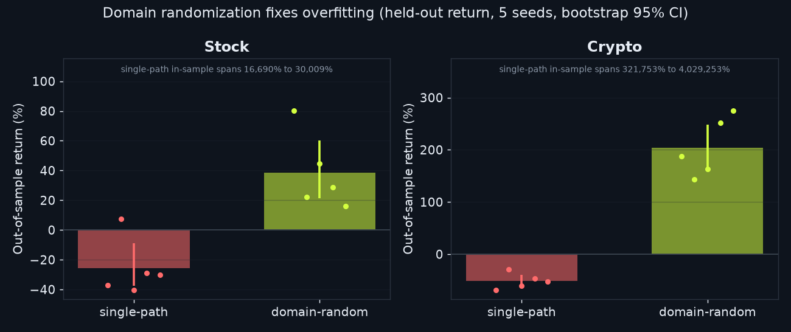
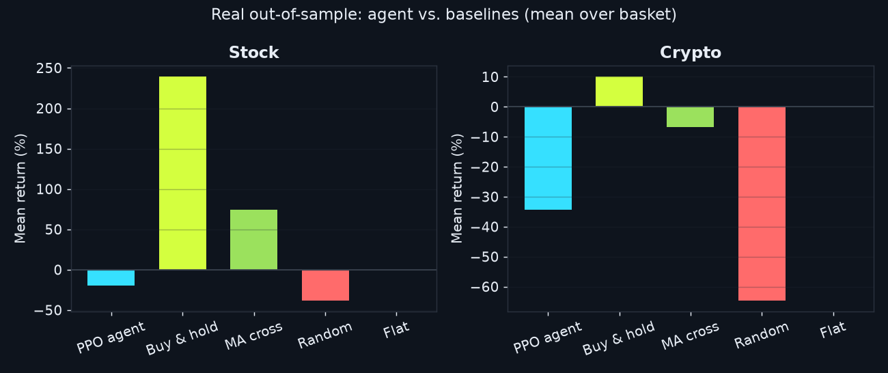

# Findings at a glance

The longer tour of the results, with the figures; every table is generated from the result files. The full account is [RESULTS.md](../RESULTS.md).

[← back to the README](../README.md)

## Results at a glance

**The core finding — domain randomization fixes overfitting.** Trained on a single
price series, the agent *memorises* it (huge in-sample returns) and then loses
out-of-sample. Trained on randomized paths, it generalizes:

**Measured like a researcher — across seeds, not one lucky run.** An earlier build
of this study published the crypto agent at +275% against buy-&-hold's +19% (commit
`d4c0ef9`), winning 4 of 6 coins. The professional move is not to ship that but to
repeat the whole walk-forward across many seeds and put a confidence interval and a
significance test on it:

<!-- BEGIN GENERATED: significance-brief -->
| Market | Agent return (95% CI, seeds) | Buy & hold | Verdict |
|---|---:|---:|---|
| Crypto | **−44.6%** `[−56%, −33%]` | +10% | indistinguishable (p = 0.22) |
| Stock | **−26.5%** `[−35%, −17%]` | +240% | significantly **worse** (p = 0.0021) |
<!-- END GENERATED: significance-brief -->

*From v2.3.0 these use the repaired PPO and a leak-free split (see "Does it hold
up?" below). In v2.2.1 the crypto row read +56.8%: the old split leaked across coins
in calendar time.*

Read the spread, not the mean. The individual seeds returned:

<!-- BEGIN GENERATED: seed-spread -->
- **Stock** — −29.6%, −44.3%, −21.1%, −24.6%, −44.1%, −32.4%, −36.7%, −13.0%, +6.1%, −25.2%
- **Crypto** — −41.8%, −69.2%, −66.9%, −56.8%, −62.7%, −42.0%, −12.2%, −27.6%, −18.4%, −48.6%
<!-- END GENERATED: seed-spread -->

On equities the agent is significantly *worse* than simply holding; on crypto it
loses money in every seed. In v2.2.1, before the split leak was found, one crypto
seed more than tripled capital while another lost money on identical code and data,
which is exactly the story a single run would have told with confidence. **There is
no reliable, seed-robust edge on real markets**, as weak-form market efficiency
predicts. A naive project ships the lucky backtest; `tools/real_significance.py` is
what catches it.

**"Maybe PPO is just the wrong tool."** That is the obvious objection to a negative
result, and the rule-based baselines cannot answer it. So two ordinary supervised
models — ridge regression on the next bar's return, logistic regression on its
direction, both written from scratch in NumPy — were fit on the *same* features and
*same* training split and traded through the *same* environment at the *same* costs.
This comparison uses the single published training run (seed 42), which is why its
PPO column differs from the ten-seed means above:

<!-- BEGIN GENERATED: supervised-brief -->
| Market | Ridge | Logistic | PPO agent | Buy & hold |
|---|---:|---:|---:|---:|
| Stocks | −6.0% | +3.1% | −19.8% | **+239.3%** |
| Crypto | +0.1% | −4.6% | −34.4% | **+10.1%** |
<!-- END GENERATED: supervised-brief -->

Neither beat buy-and-hold in either market, so two unrelated method classes land in
the same place (and both beat the PPO agent in both markets). Their in-sample directional accuracy was *above* chance, so they did
fit their training data — and none of it survived out of sample. That is the
overfitting result again, reached by a completely different route.
(`tools/supervised_report.py`)

**It also does the harder problem: cross-sectional allocation.** The same PPO agent
runs as a **portfolio allocator** — observing a whole basket and choosing long/short
weights across it under a gross-exposure budget (`tools/portfolio_experiment.py`),
benchmarked against equal-weight and a cross-sectional-momentum factor through the
identical cost model. Building and fairly evaluating that is the contribution; on
real daily data it lands in the same place as the single-asset agent — diversified
benchmarks are hard to beat, measured honestly.
