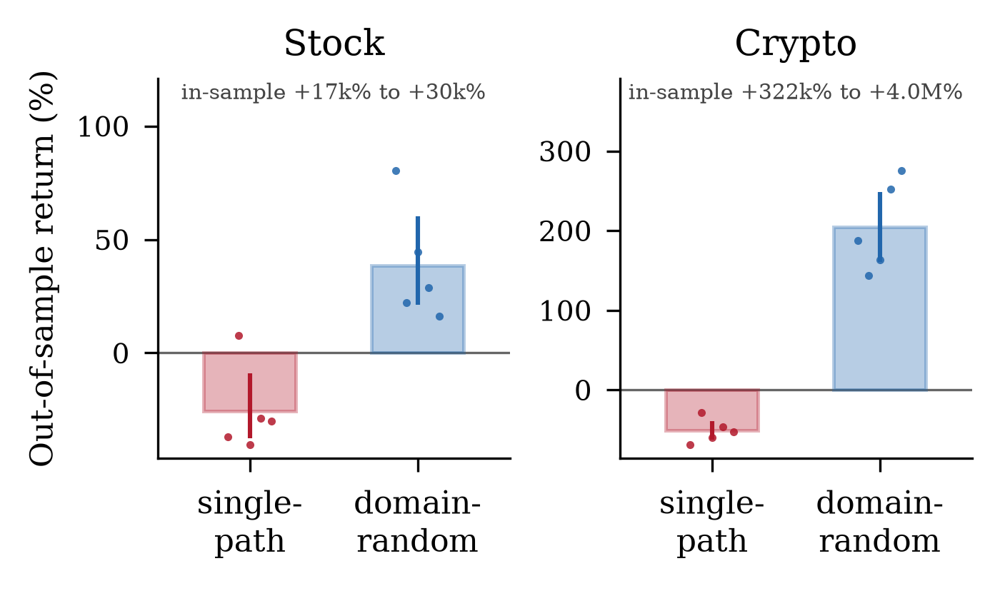

## Abstract

Deep reinforcement learning is unusually easy to fool yourself with: agents memorize their training trajectory, and a single lucky random seed can masquerade as a real result. We study both failure modes from scratch — a PyTorch implementation of Proximal Policy Optimization (PPO), two custom Gymnasium environments, and a full evaluation suite — using financial markets as a deliberately hard testbed: non-stationary, partially observable, with a noisy reward and near–random-walk signal. We ask (RQ1) whether one fixed recipe generalizes across two market regimes; (RQ2) how severely an agent overfits a single price trajectory and whether *domain randomization* repairs it; (RQ3) whether an apparent out-of-sample edge survives multi-seed significance testing; and (RQ4) whether the same holds for cross-sectional allocation. Our headline result is negative, and that is the point: on real markets the agent has *no seed-robust edge* over buy-and-hold, and our own significance tooling catches it: an earlier build of this study published a `+275%` single-seed crypto run that survived neither reseeding nor a two-month extension of the evaluation window. We further introduce a **surrogate-data falsification test** that separates “the agent is weak” from “there is no signal to find,” and validate it with a positive control on synthetic data with known structure. In doing so the project reproduces, in a new domain, the central methodological finding of Henderson et al. (2018) — that single-run RL evaluation is unreliable. We then apply that finding to our own ablation, whose domain-randomized arm is unseeded by construction and so cannot be reproduced from a single run: we report both arms as distributions over five seeds, where all four confidence intervals exclude zero.

## Introduction

Reinforcement learning (RL) research has a reproducibility problem: reported performance swings wildly across random seeds, implementation details, and evaluation choices \[1\]. Trading is a domain where these hazards are especially acute — the data-generating process drifts (non-stationarity), price alone hides the true state (partial observability), the reward is noisy, and a single historical path is trivial to memorize. That makes markets an excellent *stress test* for the general RL questions of generalization and honest evaluation, rather than a get-rich scheme.

We build the entire stack from the algorithm up — PPO \[2\] with Generalized Advantage Estimation \[3\], two market environments, a 28-feature pipeline, and the evaluation harness — so that every experiment can be instrumented and trusted. Our contributions are:

- A controlled study showing an RL agent memorizes a single price path catastrophically, and that **domain randomization** \[4, 5\] is the single change that flips held-out return from reliably negative to reliably positive — across five seeds all four confidence intervals exclude zero, in both markets (§3.2).

- A **multi-seed significance protocol** (bootstrap CIs + paired permutation tests) that reproduces the Henderson et al. \[1\] finding in a new domain: a favorable single-seed “win” does not survive resampling (§3.3).

- An original **surrogate-data falsification test** that distinguishes agent weakness from signal absence, with a synthetic positive control that confirms the test has statistical power (§3.4).

## Method

##### Algorithm.

A single `PPOAgent` (shared-trunk actor–critic) implements the clipped surrogate objective, GAE advantages, entropy regularization, orthogonal initialization, gradient clipping, and a Welford \[9\] running observation normalizer that is exported and reused at serving time. A recurrent (LSTM) actor–critic trains through the same machinery with truncated backpropagation through time.

##### Environments.

`StockTradingEnv` and `CryptoTradingEnv` subclass one `BaseTradingEnv` so accounting, transaction costs, slippage, and reward can never silently diverge. The action is a continuous target position in `[-1,1]` (fraction of equity; negative `=` short). The observation is a rolling window of 28 stationary features spanning multi-horizon momentum, moving-average ratios, RSI/MACD, Bollinger %B, Donchian position, ATR and volatility-regime signals, drawdown-from-high, volume microstructure, and cross-asset context (relative strength vs. SPY/BTC and the index’s own trend).

##### Reward.

Two selectable forms: a risk-aware return net of transaction costs with drawdown and turnover penalties, or the Differential Sharpe Ratio \[6\], an online per-step approximation to the change in the Sharpe ratio.

##### Evaluation protocol.

Data are split chronologically; feature scalers are fit on the training slice only. Agents are scored on an untouched test split by total return, annualized Sharpe, and maximum drawdown, against buy-and-hold, random, and moving-average-crossover baselines run through the identical cost model. Every headline claim is repeated across independent seeds and reported as a bootstrap 95% confidence interval, with a paired permutation test against buy-and-hold.

## Experiments

### RQ1: Regime transfer

Holding the architecture and hyperparameters fixed, we train one agent per market using only market-specific environment dynamics (cost, slippage, volatility). The same recipe produces coherent, market-appropriate behavior on both equities and crypto, confirming the unified agent is genuinely market-agnostic and that downstream differences are attributable to the environments, not the code.

### RQ2: Overfitting and domain randomization

Training on a *single* price series is a trap: the agent memorizes it. We train two otherwise-identical agents — one on a fixed synthetic path, one drawing a fresh path every episode (domain randomization) — and measure in-sample vs. out-of-sample (30 unseen paths) return (Table 1).

| Market | Train  |           In-sample |               Held-out \[95% CI\] |
|:-------|:-------|--------------------:|----------------------------------:|
| Stock  | single |   `+17k`–`+30k` |              `-26` `[-37,-9]` |
| Stock  | domain |     `-22`–`+59` |    `+38` `[+21,+60]` |
| Crypto | single | `+322k`–`+4.0M` |             `-51` `[-62,-39]` |
| Crypto | domain |    `+87`–`+460` | `+204` `[+160,+248]` |

Domain-randomization ablation, 5 seeds `×` 60k steps; all cells are percent returns. Held-out is the mean over 30 unseen paths — identical for every arm and seed — with a bootstrap 95% CI across seeds. In-sample is a *range* over seeds, not a mean: it is one leveraged compounding return on a memorized path and spans orders of magnitude. The domain-randomized arm’s in-sample figure is its return on the very path the single-path agent memorized.

<figure id="fig:ablation" data-latex-placement="t">

<figcaption>Held-out return by training regime. Bars are the mean over seeds, whiskers the bootstrap 95% CI, and dots the individual seeds — so the reader sees <em>n</em> and the spread rather than a bar alone. The in-sample range is annotated rather than plotted: it spans several orders of magnitude and would flatten everything else to a line.</figcaption>
</figure>

The astronomical in-sample figures are not a win — they are the overfitting signature. Domain randomization is the single change that turns a memorizer into a generalizer, echoing sim-to-real transfer \[4\] and RL generalization benchmarks \[5\].

Across five seeds all four intervals exclude zero: single-path training is reliably unprofitable out-of-sample and domain randomization is reliably profitable, in both markets. The effect is therefore robust to seed choice, which is the property the rest of this paper spends its time showing that real-market edges lack.

Two caveats the distribution makes visible and a single run would hide. Equities are the weaker case — one of five single-path seeds returned `+8%` rather than a loss, and the interval reaches to `-9%`, so “reliably negative” there rests on a margin, not a chasm. And the crypto domain-randomized mean is inflated by one seed at `+307%` against a cluster near `+60%`; the interval is correspondingly wide. Figure 1 plots the individual seeds for exactly this reason.

### RQ3: Does the edge survive multiple seeds?

A single backtest is an anecdote. On synthetic markets where a signal provably exists, the agent is repeatably profitable across 5 seeds — its bootstrap interval excludes zero in both markets — yet remains statistically indistinguishable from buy-and-hold under a paired permutation test. On *real* markets the two markets fail differently (Table 2). On equities the agent is significantly *worse* than the mega-cap bull. On crypto the mean across seeds is positive and its interval excludes zero, so the agent did make money on average; what it did not do is beat buy-and-hold, which the paired test cannot distinguish it from. The per-seed returns span more than an order of magnitude, and with 5 seeds a sign-flip test on that axis cannot reach `p≤0.05` even in principle — its floor is `2/2^5=0.0625`. An earlier build of this study (commit `d4c0ef9`) published the crypto agent at `+275%` against buy-and-hold’s `+19%`; rebuilding the identical recipe — same code, same seed, same budget — against a data snapshot pinned two months later erased that headline entirely. The run was not merely seed-lucky but window-lucky.

| Market |             Agent (95% CI) |    vs. B&H | Verdict                  |
|:-------|---------------------------:|-----------:|:-------------------------|
| Crypto | `+56.8%` `[+16,+106]` |  `+23%` | indist. (`p=0.7871`) |
| Stock  |  `-19.1%` `[-27,-11]` | `-259%` | worse (`p=0.0021`)   |

Real-market multi-seed significance (5 seeds, held-out walk-forward). The lucky single-seed crypto “win” does not survive resampling.

This is exactly the warning of Henderson et al. \[1\]: a single run is not evidence. A naive project ships the lucky table; the significance test is what catches it. *Reporting the catch is the contribution.*

### RQ (original): A surrogate-data falsification test

The results above show the agent does not beat the market — but is that because the agent is weak, or because there is no exploitable structure to find? We adapt **surrogate-data testing** from nonlinear time-series analysis \[7\]. A *return-shuffled surrogate* randomly permutes a series’ daily log-returns and re-integrates them. Because a sum is permutation-invariant, the surrogate ends at the identical price — *buy-and-hold is unchanged* — but momentum, autocorrelation, and volatility clustering are destroyed. We then train and evaluate the same recipe on structured data and on its surrogate and compare the agent’s edge over buy-and-hold.

The logic is a controlled falsification. On synthetic data with a *known* AR(1) momentum signal, a valid test must find `edge_structured ≫
edge_surrogate`: the agent should exploit the signal and lose that edge once shuffling removes it. This is our positive control (Table 3), and it confirms the test has power. Applied to real markets, the test finds *no* significant difference between real and return-shuffled data: on equities the agent does no better on real prices than on structure-free surrogates (`Δ` nowhere near significant), the clean null predicted by §3.3. The crypto arm is inconclusive — heavy-tailed returns produce occasional blow-ups on reshuffled paths that inflate the surrogate loss and dominate the mean, and the gap is not significant; a median-based or exposure-capped statistic is the natural remedy. Neither market shows demonstrable exploited structure, corroborating §3.3 from a fresh angle and turning “markets are efficient” from an appeal to authority into a falsifiable test.

| Market |  Structured |   Surrogate |   `Δ` |      `p` |
|:-------|------------:|------------:|-------------:|-----------:|
| Crypto | `+68.6%` | `-55.7%` | `+124.3%` | `0.0075` |
| Stock  |  `+1.8%` | `-47.7%` |  `+49.5%` | `0.0026` |

Surrogate-data test, synthetic positive control (edge `=` agent `-` buy-and-hold return, mean over 10 held-out paths, 5 seeds, 60k steps; `p` from a paired permutation test of structured vs. surrogate edge). When a known signal exists the agent earns a positive edge; destroying it by shuffling collapses the edge sharply negative — the test has power in both markets.

### RQ4: Cross-sectional allocation

Single-asset timing is only half the problem. The same PPO agent generalizes to a `PortfolioTradingEnv` that observes a whole basket and emits an `N`-dimensional long/short weight vector under a gross-exposure budget, benchmarked against an equal-weight (`1/N`) portfolio and a cross-sectional momentum factor. On equities the learned allocator clears both random weights and the momentum factor yet is beaten by equal-weight by more than 150 points of return; on crypto it is level with random weights on return, ahead only on a risk-adjusted basis. The contribution is the working, budget-constrained RL allocator and its apples-to-apples evaluation — the same lesson at a harder problem: naive diversification is hard to beat when the per-asset signal is weak.

## Related Work

This project reproduces and cross-domain stress-tests results the field already considers important. Henderson et al. \[1\] document the unreliability of single-run deep-RL evaluation; §3.3 reproduces it on markets. Tobin et al. \[4\] introduce domain randomization for sim-to-real transfer and Cobbe et al. \[5\] formalize train/test generalization in RL; §3.2 measures the gap domain randomization closes. The algorithm is PPO \[2\] with GAE \[3\]; the Differential Sharpe Ratio reward is due to Moody and Saffell \[6\]. The negative real-market result is consistent with weak-form market efficiency \[8\], and surrogate-data testing follows Theiler et al. \[7\].

## Limitations and Conclusion

The bottleneck is signal, not the agent: raw daily OHLCV carries little exploitable structure, so richer exogenous data (macro series, sentiment) — not a bigger network — is the natural next lever. Multi-fold walk-forward and a head-to-head feed-forward-vs-LSTM study are supported by the codebase and left as future work.

A second limitation concerns the ablation of §3.2, and we state it plainly because we found it in our own results. The two arms are not equally reproducible, and the asymmetry is structural rather than incidental. The single-path arm draws its training series with an explicit seed, and repeated invocations reproduce it exactly. The domain-randomized arm, by construction, draws a *fresh unseeded* series every episode — that is what domain randomization means — so the run seed does not determine its data stream and no single run of it is reproducible even in principle. Any comparison between the arms that quotes one run of each is therefore not a controlled comparison.

This is why §3.2 reports each arm as a distribution over seeds with bootstrap intervals, and why its conclusion is stated in terms of held-out return — a mean over 30 fixed evaluation paths — rather than the single-path in-sample figure, which averages nothing and compounds along one memorized trajectory. Training additionally does not run under `torch.use_deterministic_algorithms`, so exact bitwise reproducibility is not guaranteed for either arm across machines. An earlier version of this table quoted a single run per cell; that version was also stale with respect to a change in the observation feature set, which is the ordinary way such numbers rot and an argument for regenerating them from a script rather than transcribing them.

Our conclusion is deliberately unglamorous and, we argue, more valuable than a suspicious backtest: built and evaluated honestly, a from-scratch deep-RL trader finds no reliable edge on real markets — and the methodology that establishes this rigorously is the actual result.

## References

1.  P. Henderson, R. Islam, P. Bachman, J. Pineau, D. Precup, D. Meger. Deep Reinforcement Learning that Matters. *AAAI*, 2018.

2.  J. Schulman, F. Wolski, P. Dhariwal, A. Radford, O. Klimov. Proximal Policy Optimization Algorithms. *arXiv:1707.06347*, 2017.

3.  J. Schulman, P. Moritz, S. Levine, M. Jordan, P. Abbeel. High-Dimensional Continuous Control Using GAE. *ICLR*, 2016.

4.  J. Tobin et al. Domain Randomization for Transferring Deep Neural Networks from Simulation to the Real World. *IROS*, 2017.

5.  K. Cobbe, O. Klimov, C. Hesse, T. Kim, J. Schulman. Quantifying Generalization in Reinforcement Learning. *ICML*, 2019.

6.  J. Moody, M. Saffell. Learning to Trade via Direct Reinforcement. *IEEE Trans. Neural Networks*, 2001.

7.  J. Theiler et al. Testing for Nonlinearity in Time Series: The Method of Surrogate Data. *Physica D*, 1992.

8.  E. Fama. Efficient Capital Markets. *J. Finance*, 1970.

9.  B. P. Welford. Note on a Method for Calculating Corrected Sums of Squares and Products. *Technometrics*, 1962.
