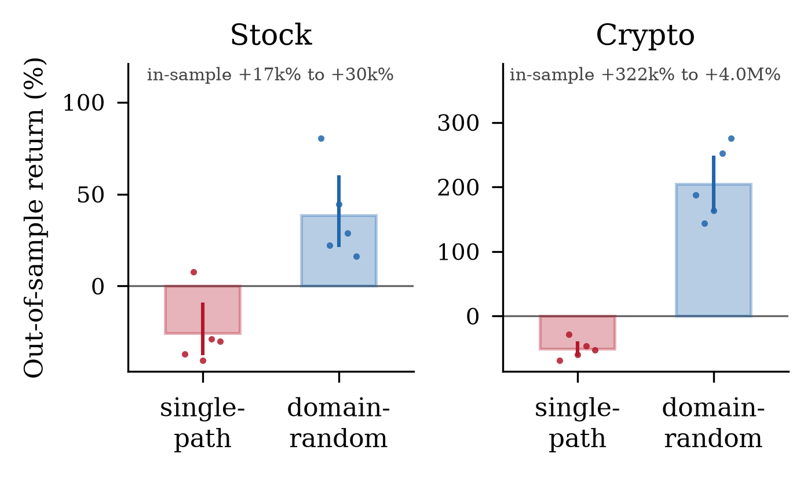

## Abstract

Deep reinforcement learning is unusually easy to fool yourself with: agents memorize their training trajectory, and a single lucky random seed can masquerade as a real result. We study both failure modes from scratch — a PyTorch implementation of Proximal Policy Optimization (PPO), two custom Gymnasium environments, and a full evaluation suite — using financial markets as a deliberately hard testbed: non-stationary, partially observable, with a noisy reward and near–random-walk signal. We ask (RQ1) whether one fixed recipe generalizes across two market regimes; (RQ2) how severely an agent overfits a single price trajectory and whether *domain randomization* repairs it; (RQ3) whether an apparent out-of-sample edge survives multi-seed significance testing; and (RQ4) whether the same holds for cross-sectional allocation. Our headline result is negative, and that is the point: on real markets the agent has *no seed-robust edge* over buy-and-hold, and our own significance tooling catches it: an earlier build of this study published a `+275%` single-seed crypto run that survived neither reseeding nor a two-month extension of the evaluation window. We further introduce a **surrogate-data falsification test** that separates “the agent is weak” from “there is no signal to find,” and validate it with a positive control on synthetic data with known structure. In doing so the project reproduces, in a new domain, the central methodological finding of Henderson et al. (2018) — that single-run RL evaluation is unreliable. We then apply that finding to our own ablation: we report both arms as distributions over ten seeds, where all four confidence intervals exclude zero, after finding and fixing a seeding bug that had left the domain-randomized arm unreproducible. Finally (RQ5) we turn the same PPO to a problem RL is suited to — hedging a short option when trading costs money — where theory gives answers to check against. The agent approximately recovers the Black-Scholes delta without observing it, learns to trade less as costs rise, and on 237 real one-month SPY episodes it never trained on, ties a tuned no-trade-band hedge at low costs and beats it at high costs. Last (RQ6), we put the study through pre-registered checks from current deep-RL evaluation practice. They find two real flaws: our PPO trails Stable-Baselines3 on two of four standard benchmarks (seven implementation details close the gap on three of the four), and the crypto split leaked across coins in calendar time. Neither changes the conclusion: with the repaired PPO, Stable-Baselines3’s PPO and SAC, at budgets up to `10^6` steps, on a leak-free split and on a stock universe chosen without hindsight, no agent beats buy-and-hold.

## Introduction

Reinforcement learning (RL) research has a reproducibility problem: reported performance swings wildly across random seeds, implementation details, and evaluation choices \[1\]. Trading is a domain where these hazards are especially acute — the data-generating process drifts (non-stationarity), price alone hides the true state (partial observability), the reward is noisy, and a single historical path is trivial to memorize. That makes markets an excellent *stress test* for the general RL questions of generalization and honest evaluation, rather than a get-rich scheme.

We build the entire stack from the algorithm up — PPO \[2\] with Generalized Advantage Estimation \[3\], two market environments, a 28-feature pipeline, and the evaluation harness — so that every experiment can be instrumented and trusted. Our contributions are:

- A controlled study showing an RL agent memorizes a single price path catastrophically, and that **domain randomization** \[4, 5\] is the single change that flips held-out return from reliably negative to reliably positive — across ten seeds all four confidence intervals exclude zero, in both markets (§3.2).

- A **multi-seed significance protocol** (bootstrap CIs + paired permutation tests) that reproduces the Henderson et al. \[1\] finding in a new domain: a favorable single-seed “win” does not survive resampling (§3.3).

- An original **surrogate-data falsification test** that distinguishes agent weakness from signal absence, with a synthetic positive control that confirms the test has statistical power (§3.4).

- A **hedging study** in which the same PPO, trained only on simulated paths, is checked against two known answers (delta at zero cost, a widening no-trade band with costs) and then tested on real SPY history (§3.6).

- A **pre-registered audit of the study itself** (§3.7): the PPO benchmarked against a reference implementation, the trading result re-run with other implementations, another algorithm, larger budgets, a leak-free split and a hindsight-free universe, and every reported `p`-value corrected for multiple testing.

## Method

### Algorithm.

A single `PPOAgent` (shared-trunk actor–critic) implements the clipped surrogate objective, GAE advantages, entropy regularization, orthogonal initialization, gradient clipping, and a Welford \[9\] running observation normalizer that is exported and reused at serving time. A recurrent (LSTM) actor–critic trains through the same machinery with truncated backpropagation through time.

### Environments.

`StockTradingEnv` and `CryptoTradingEnv` subclass one `BaseTradingEnv` so accounting, transaction costs, slippage, and reward can never silently diverge. The action is a continuous target position in `[-1,1]` (fraction of equity; negative `=` short). The observation is a rolling window of 28 stationary features spanning multi-horizon momentum, moving-average ratios, RSI/MACD, Bollinger %B, Donchian position, ATR and volatility-regime signals, drawdown-from-high, volume microstructure, and cross-asset context (relative strength vs. SPY/BTC and the index’s own trend).

### Reward.

Two selectable forms: a risk-aware return net of transaction costs with drawdown and turnover penalties, or the Differential Sharpe Ratio \[6\], an online per-step approximation to the change in the Sharpe ratio.

### Evaluation protocol.

Data are split chronologically; feature scalers are fit on the training slice only. Agents are scored on an untouched test split by total return, annualized Sharpe, and maximum drawdown, against buy-and-hold, random, and moving-average-crossover baselines run through the identical cost model. Every headline claim is repeated across independent seeds and reported as a bootstrap 95% confidence interval, with a paired permutation test against buy-and-hold.

## Experiments

### RQ1: Regime transfer

Holding the architecture and hyperparameters fixed, we train one agent per market using only market-specific environment dynamics (cost, slippage, volatility). The same recipe produces coherent, market-appropriate behavior on both equities and crypto, confirming the unified agent is genuinely market-agnostic and that downstream differences are attributable to the environments, not the code.

### RQ2: Overfitting and domain randomization

Training on a *single* price series is a trap: the agent memorizes it. We train two otherwise-identical agents — one on a fixed synthetic path, one drawing a fresh path every episode (domain randomization) — and measure in-sample vs. out-of-sample (30 unseen paths) return (Table 1).

| Market | Train  |          In-sample |               Held-out \[95% CI\] |
|:-------|:-------|-------------------:|----------------------------------:|
| Stock  | single |   `+6k`–`+31k` |             `-25` `[-33,-15]` |
| Stock  | domain |    `-22`–`+59` |    `+31` `[+21,+44]` |
| Crypto | single | `+87k`–`+4.0M` |             `-44` `[-59,-21]` |
| Crypto | domain |   `+24`–`+460` | `+187` `[+147,+229]` |

Domain-randomization ablation, 10 seeds `×` 60k steps; all cells are percent returns. Held-out is the mean over 30 unseen paths — identical for every arm and seed — with a bootstrap 95% CI across seeds. In-sample is a *range* over seeds, not a mean: it is one leveraged compounding return on a memorized path and spans orders of magnitude. The domain-randomized arm’s in-sample figure is its return on the very path the single-path agent memorized.

<figure id="fig:ablation" data-latex-placement="t">

<figcaption>Held-out return by training regime. Bars are the mean over seeds, whiskers the bootstrap 95% CI, and dots the individual seeds — so the reader sees <em>n</em> and the spread rather than a bar alone. The in-sample range is annotated rather than plotted: it spans several orders of magnitude and would flatten everything else to a line.</figcaption>
</figure>

The astronomical in-sample figures are not a win — they are the overfitting signature. Domain randomization is the single change that turns a memorizer into a generalizer, echoing sim-to-real transfer \[4\] and RL generalization benchmarks \[5\].

Across ten seeds all four intervals exclude zero: single-path training is reliably unprofitable out-of-sample and domain randomization is reliably profitable, in both markets. The effect is therefore robust to seed choice, which is the property the rest of this paper spends its time showing that real-market edges lack.

Two caveats the distribution makes visible and a single run would hide. “Reliably negative” describes the mean, not every seed: in each market one of the ten single-path seeds finished positive out-of-sample (stocks `+7.6%`, crypto `+47%`), so a reader quoting any one run could have drawn the opposite conclusion. The domain-randomized arm, by contrast, is positive in all twenty runs (stocks `+11` to `+80%`, crypto `+82` to `+291%`), with no single seed carrying the mean. Figure 1 plots the individual seeds for exactly this reason.

### RQ3: Does the edge survive multiple seeds?

A single backtest is an anecdote. On synthetic markets where a signal provably exists, the agent is repeatably profitable across 5 seeds — its bootstrap interval excludes zero in both markets — yet remains statistically indistinguishable from buy-and-hold under a paired permutation test. On *real* markets (Table 4; repaired PPO and leak-free split, §3.7) the agent is significantly *worse* than buy-and-hold on equities, and on crypto it loses money in every seed while remaining statistically indistinguishable from a buy-and-hold that itself made little. In the previous version of this study, whose crypto split leaked, the crypto mean was positive with an interval above zero and the per-seed returns spanned `-29%` to `+226%`: a single run of either sign would have told a confident and wrong story. The paired test runs across the held-out tickers, not across seeds. An earlier build of this study (commit `d4c0ef9`) published the crypto agent at `+275%` against buy-and-hold’s `+19%`; rebuilding the identical recipe — same code, same seed, same budget — against a data snapshot pinned two months later erased that headline entirely. The run was not merely seed-lucky but window-lucky. Two later checks are in Table 2. Re-running the same ten seeds with identical code, budget and archived data on a different machine (same PyTorch and NumPy) leaves the means within a point and the equity verdict unchanged, but moves the crypto comparison across the 0.05 line: individual seeds diverge across hardware, and six coins leave the paired test little margin. The crypto agent is not better than buy-and-hold in either run; whether it is worse is not settled. Adjusting for risk does not help it: its Sharpe ratio is below buy-and-hold’s, and regressed on the asset it traded, its alpha is negative in both markets, with a crypto beta near zero that rules out “short in a rising market” as the explanation.

| Market | Published | Re-run | Sharpe | Alpha | Beta |
|:---|---:|---:|---:|---:|---:|
| Stock | `-26.5%` (`p=0.0021`) | `-25.8%` (`p=0.0021`) | `-0.53` / `+1.12` (`p=0.0021`) | `-12.6%` (`p=0.0021`) | `0.14` |
| Crypto | `-44.6%` (`p=0.22`) | `-45.4%` (`p=0.03`) | `-0.61` / `+0.32` (`p=0.03`) | `-32.2%` (`p=0.03`) | `0.00` |

Hardware replication and risk adjustment. Mean basket return and paired-test `p` against buy-and-hold for the published run and a re-run of the same seeds (100–109) on a different machine; then, from the re-run, annualised Sharpe ratio (agent / buy-and-hold, paired test across tickers) and the agent’s annualised alpha (sign-flip test against zero) and beta from regressing its daily returns on the traded asset’s.

A pre-registered follow-up (Table 3) answers the remaining objections. At 30 seeds, the stock agent trails buy-and-hold in all 300 runs. The crypto agent trails on five of six coins, which with six coins is not significant (`p=0.19`; the test’s floor is 0.031). Retrained across four periods of history on one calendar for every ticker, the agent trails buy-and-hold on stocks in every period. On crypto it trails in three of four. In the fourth, a 46% fall, it lost less than holding because its net exposure was small (beta 0.11), and its alpha in that period is still negative. Re-run at 10 seeds and the full budget, the hyper-parameter sweep finds no configuration with a positive edge. The positions the policy holds explain the near-zero beta. It is almost never flat; it is long about half the time and short most of the rest. The sign of its position matches the next day’s move on 50.0% of days, no better than a coin flip. It also changes position by over half its equity daily, at a cost of roughly 11% (stocks) and 38% (crypto) a year, about the size of its negative alpha.

| Market | 30 seeds | Walk-forward | Behind | Sweep | Hit rate |
|:---|---:|---:|---:|---:|---:|
| Stock | `-29.8%` vs `+239.5%` (`p=0.0021`) | `-50.7%` (`p<0.0001`) | 4/4 | 0/9 | 0.498 |
| Crypto | `-40.5%` vs `+10.3%` (`p=0.19`) | `-26.1%` (`p=0.02`) | 3/4 | 0/9 | 0.500 |

The pre-registered depth study. Thirty seeds (100–129): mean basket return against buy-and-hold, paired permutation test across tickers. Walk-forward: four periods, retrained from scratch each time, 10 seeds; mean agent minus buy-and-hold over (ticker, period) pairs, and the number of periods in which the agent trails. Sweep: configurations, of nine, with a positive mean edge (10 seeds, 150k steps). Hit rate: share of non-flat days on which the position’s sign matched the next move.

| Market |            Agent (95% CI) |    vs. B&H | Verdict                  |
|:-------|--------------------------:|-----------:|:-------------------------|
| Crypto | `-44.6%` `[-56,-33]` |  `-55%` | indist. (`p=0.2237`) |
| Stock  | `-26.5%` `[-35,-17]` | `-266%` | worse (`p=0.0021`)   |

Real-market multi-seed significance (10 seeds, held-out walk-forward; `p` from a paired permutation test across held-out tickers). Repaired PPO and one calendar cut for every ticker (§3.7); seeds 100–109, 150k steps.

This is exactly the warning of Henderson et al. \[1\]: a single run is not evidence. A naive project ships the lucky table; the significance test is what catches it. *Reporting the catch is the contribution.*

### RQ (original): A surrogate-data falsification test

The results above show the agent does not beat the market — but is that because the agent is weak, or because there is no exploitable structure to find? We adapt **surrogate-data testing** from nonlinear time-series analysis \[7\]. A *return-shuffled surrogate* randomly permutes a series’ daily log-returns and re-integrates them. Because a sum is permutation-invariant, the surrogate ends at the identical price — *buy-and-hold is unchanged* — but momentum, autocorrelation, and volatility clustering are destroyed. We then train and evaluate the same recipe on structured data and on its surrogate and compare the agent’s edge over buy-and-hold.

The logic is a controlled falsification. On synthetic data with a *known* AR(1) momentum signal, a valid test must find `edge_structured ≫
edge_surrogate`: the agent should exploit the signal and lose that edge once shuffling removes it. This is our positive control (Table 5), and it confirms the test has power. Applied to real markets, the test finds *no* significant difference between real and return-shuffled data: on equities the agent does no better on real prices than on structure-free surrogates (`Δ` nowhere near significant), the clean null predicted by §3.3. The crypto arm is inconclusive — heavy-tailed returns produce occasional blow-ups on reshuffled paths that inflate the surrogate loss and dominate the mean, and the gap is not significant; a median-based or exposure-capped statistic is the natural remedy. Neither market shows demonstrable exploited structure, corroborating §3.3 from a fresh angle and turning “markets are efficient” from an appeal to authority into a falsifiable test.

| Market |  Structured |   Surrogate |   `Δ` |      `p` |
|:-------|------------:|------------:|-------------:|-----------:|
| Crypto | `+68.6%` | `-55.7%` | `+124.3%` | `0.0075` |
| Stock  |  `+1.8%` | `-47.7%` |  `+49.5%` | `0.0026` |

Surrogate-data test, synthetic positive control (edge `=` agent `-` buy-and-hold return, mean over 10 held-out paths, 5 seeds, 60k steps; `p` from a paired permutation test of structured vs. surrogate edge). When a known signal exists the agent earns a positive edge; destroying it by shuffling collapses the edge sharply negative — the test has power in both markets.

### RQ4: Cross-sectional allocation

Single-asset timing is only half the problem. The same PPO agent generalizes to a `PortfolioTradingEnv` that observes a whole basket and emits an `N`-dimensional long/short weight vector under a gross-exposure budget, benchmarked against an equal-weight (`1/N`) portfolio and a cross-sectional momentum factor. On equities the learned allocator clears both random weights and the momentum factor yet is beaten by equal-weight by more than 150 points of return; on crypto it is level with random weights on return, ahead only on a risk-adjusted basis. The contribution is the working, budget-constrained RL allocator and its apples-to-apples evaluation — the same lesson at a harder problem: naive diversification is hard to beat when the per-asset signal is weak.

### RQ5: A decision problem where RL helps

RQ1–RQ4 ask the agent to forecast; it cannot. Hedging is a decision problem whose answer does not require a forecast. Sell one at-the-money call with 21 trading days to expiry; each day choose a hedge `h∈[0,1]` shares per option, paying a proportional cost `c` on the notional traded. A day’s P&L is `h Δ S-Δ V-c |Δ h| S` with `V` marked at Black-Scholes, and the reward is `x-½x^2` for a P&L of `x%` of the notional, a mean-variance objective \[11\]. With `c=0` the optimum is the Black-Scholes delta; with `c>0` it is a no-trade band around delta that widens with `c` \[12\]; in general it has no closed form, which is where deep hedging \[10\] applies. The agent observes `ln(S/K)`, time left, implied volatility and its own hedge — not delta — and is trained only on simulated geometric-Brownian paths with a fresh volatility per path (domain randomization, §3.2), ten seeds per cost. The strongest baseline is delta with a no-trade band whose width is tuned per cost on separate validation paths. The real test uses 237 non-overlapping one-month SPY episodes (2007–2026) with implied volatility `0.875×`VIX.

| Cost  |      Agent |      Delta |       Band | Seeds `>` band      |
|:------|-----------:|-----------:|-----------:|:----------------------|
| none  | `-0.107` | `-0.100` | `-0.100` | 4/10 (`p=0.315`)  |
| 0.05% | `-0.207` | `-0.224` | `-0.216` | 7/10 (`p=0.805`)  |
| 0.2%  | `-0.506` | `-0.611` | `-0.547` | 9/10 (`p=0.006`)  |
| 1%    | `-1.776` | `-3.122` | `-2.355` | 10/10 (`p=0.002`) |

Hedging on real SPY history (higher score is better; median of 10 seeds). Seeds beating the tuned band, with a paired permutation `p` across seeds.

Both checks are met in part or in full. At `c=0` the agent’s hedge stays within about 0.04 shares of delta and removes about 97% of the risk delta removes, but scores below delta in all ten seeds: close, not exact. As `c` rises its turnover falls and the gap it tolerates to delta grows, a learned no-trade band. Against the tuned band (Table 6) the agent ties at low costs and wins at 0.2% and 1%; in simulation, where the band was tuned, the band wins below 1%. On real data the agent’s worst 5% of months are milder than the band’s at every cost; we do not test why. Prices are modelled, only the underlying is used to hedge, and rates and dividends are omitted. A first check against real SPY option quotes finds the volatility assumption close (at-the-money implied volatility `≈ 0.86×` VIX) and the zero-cost agents hedging one-day moves somewhat worse than delta, as in simulation; full episodes on real quotes are accumulating and are reported in the repository as they complete.

### RQ6: Does the study hold up?

A negative result is only as good as the machinery behind it, so we applied to the study the checks current practice asks of deep-RL results \[1, 13\], each pre-registered with dated amendments before its runs, on the replication’s archived data and seeds 200–209.

#### Is the PPO correct?

Trained on four standard continuous-control tasks with the trading study’s own hyper-parameters, our PPO learns, but it is significantly behind Stable-Baselines3 (SB3) \[14\] configured identically on HalfCheetah and Pendulum (Table 7). No single change closes the gap; seven standard implementation details \[15\] together do, on three of the four tasks: a separate critic trunk; storing observations normalised as the policy saw them (ours re-normalised them after the rollout with moved statistics, so each update began from a ratio `≠ 1`); no tanh on the policy mean; bootstrapping time-limit cut-offs; SB3’s value loss; Adam `ε=10^-5`; per-minibatch advantage normalisation. Pendulum stays unexplained.

| Task | Random | Ours | Repaired | SB3 |
|:---|---:|---:|---:|---:|
| Pendulum-v1 | `-1,161` | `-1,112^↓` | `-1,094^↓` | `-407` |
| InvertedPendulum-v5 | `5` | `1,000` | `1,000` | `997` |
| HalfCheetah-v5 | `-292` | `1,495^↓` | `4,176` | `3,755` |
| Hopper-v5 | `17` | `1,246` | `1,499` | `1,691` |

Our PPO against Stable-Baselines3 under identical hyper-parameters (IQM of final return, 10 seeds). `↓`: significantly worse than SB3.

#### A calendar leak.

SAC’s crypto result in the published design (+224%) exposed a flaw: each coin was cut 60/40 on its own history, and crypto histories start in different years, so ETH, ADA, XRP and SOL were trained through 15–27 months that are BTC’s and LTC’s test period. Cut on one calendar date, every algorithm loses money on crypto (Table 8). Every published crypto number is inflated by the leak; stock series share their dates and are unaffected.

|                   |        B&H |      Ours |      Rep. |       SB3 |        SAC |
|:------------------|-----------:|----------:|----------:|----------:|-----------:|
| Stocks            | `+240%` | `-23%` | `-30%` | `-18%` |  `-25%` |
| Crypto, leaky     |  `+33%` | `+13%` |         – | `+28%` | `+224%` |
| Crypto, leak-free |  `+10%` | `-29%` | `-38%` | `-64%` |  `-30%` |

Held-out basket return at 150k steps (IQM over seeds 200–209) by implementation and algorithm (Rep.: repaired PPO; SB3: Stable-Baselines3 PPO; leaky: the published per-coin split). On stocks every agent is significantly worse than buy-and-hold (`p=0.002`); on the leak-free crypto split none is better.

#### Budget, universe, multiple testing.

Scored at seven budgets from 25k to `10^6` steps, no arm beats buy-and-hold at any of them. On the 30 Dow members of 2016-08-29, a universe chosen without hindsight, buy-and-hold falls from `+240%` to `+101%`, and the agent still loses about a quarter of its capital and is significantly worse than buy-and-hold. Of the fourteen `p`-values this paper reports, every claim of a difference survives Holm–Bonferroni within its research question; two (the hedging win at 0.2% cost and the crypto surrogate control) do not survive one family of all fourteen.

## Related Work

This project reproduces and cross-domain stress-tests results the field already considers important. Henderson et al. \[1\] document the unreliability of single-run deep-RL evaluation; §3.3 reproduces it on markets. Tobin et al. \[4\] introduce domain randomization for sim-to-real transfer and Cobbe et al. \[5\] formalize train/test generalization in RL; §3.2 measures the gap domain randomization closes. The algorithm is PPO \[2\] with GAE \[3\]; the Differential Sharpe Ratio reward is due to Moody and Saffell \[6\]. The negative real-market result is consistent with weak-form market efficiency \[8\], and surrogate-data testing follows Theiler et al. \[7\]. The hedging study (§3.6) follows deep hedging \[10\] and RL replication \[11\], and is checked against the no-trade band of Whalley and Wilmott \[12\].

## Limitations and Conclusion

The bottleneck is signal, not the agent: raw daily OHLCV carries little exploitable structure, so richer exogenous data (macro series, sentiment) — not a bigger network — is the natural next lever. Six coins also limit the crypto test: across six tickers a sign-flip test cannot give `p` below 0.031, so on total return the crypto verdict stays “not distinguishable” unless the agent trails on every coin (Table 3). A head-to-head feed-forward-vs-LSTM study is supported by the codebase and left as future work.

A second note concerns the ablation of §3.2, because we found the problem in our own results. The domain-randomized arm draws a fresh path every episode — that is what domain randomization means — and in earlier builds that stream was unseeded, so the run seed did not determine its data and no single run of that arm could be reproduced. Both arms are now seeded (the path stream comes from a per-seed factory), and a given seed reproduces its run exactly. Any comparison that quotes one run of each arm would still not be a fair summary of either.

This is why §3.2 reports each arm as a distribution over seeds with bootstrap intervals, and why its conclusion is stated in terms of held-out return — a mean over 30 fixed evaluation paths — rather than the single-path in-sample figure, which averages nothing and compounds along one memorized trajectory. Training additionally does not run under `torch.use_deterministic_algorithms`, so exact bitwise reproducibility is not guaranteed for either arm across machines. An earlier version of this table quoted a single run per cell; that version was also stale with respect to a change in the observation feature set, which is the ordinary way such numbers rot and an argument for regenerating them from a script rather than transcribing them.

The audit of §3.7 adds two limitations of our own making: every number in §§3.3–3.6 was produced by the published PPO, which §3.7 shows was not equivalent to a reference implementation, and the crypto rows used a split that leaked. Both were re-run for the central result and did not change it; the remaining real-data crypto experiments have not been.

Our conclusion is deliberately unglamorous and, we argue, more valuable than a suspicious backtest: built and evaluated honestly, a from-scratch deep-RL trader finds no reliable edge on real markets — and the methodology that establishes this rigorously is the actual result. The same code is useful where the problem is a decision with costs rather than a forecast: hedging an option, it recovers what theory predicts and, on real prices, does better than the tuned textbook rule where costs are high (§3.6).

## References

1.  P. Henderson, R. Islam, P. Bachman, J. Pineau, D. Precup, D. Meger. Deep Reinforcement Learning that Matters. *AAAI*, 2018.

2.  J. Schulman, F. Wolski, P. Dhariwal, A. Radford, O. Klimov. Proximal Policy Optimization Algorithms. *arXiv:1707.06347*, 2017.

3.  J. Schulman, P. Moritz, S. Levine, M. Jordan, P. Abbeel. High-Dimensional Continuous Control Using GAE. *ICLR*, 2016.

4.  J. Tobin et al. Domain Randomization for Transferring Deep Neural Networks from Simulation to the Real World. *IROS*, 2017.

5.  K. Cobbe, O. Klimov, C. Hesse, T. Kim, J. Schulman. Quantifying Generalization in Reinforcement Learning. *ICML*, 2019.

6.  J. Moody, M. Saffell. Learning to Trade via Direct Reinforcement. *IEEE Trans. Neural Networks*, 2001.

7.  J. Theiler et al. Testing for Nonlinearity in Time Series: The Method of Surrogate Data. *Physica D*, 1992.

8.  E. Fama. Efficient Capital Markets. *J. Finance*, 1970.

9.  B. P. Welford. Note on a Method for Calculating Corrected Sums of Squares and Products. *Technometrics*, 1962.

10. H. Buehler, L. Gonon, J. Teichmann, B. Wood. Deep Hedging. *Quantitative Finance*, 19(8), 2019.

11. P. N. Kolm, G. Ritter. Dynamic Replication and Hedging: A Reinforcement Learning Approach. *J. Financial Data Science*, 1(1), 2019.

12. A. E. Whalley, P. Wilmott. An Asymptotic Analysis of an Optimal Hedging Model for Option Pricing with Transaction Costs. *Mathematical Finance*, 7(3), 1997.

13. R. Agarwal, M. Schwarzer, P. S. Castro, A. Courville, M. G. Bellemare. Deep Reinforcement Learning at the Edge of the Statistical Precipice. *NeurIPS*, 2021.

14. A. Raffin, A. Hill, A. Gleave, A. Kanervisto, M. Ernestus, N. Dormann. Stable-Baselines3: Reliable Reinforcement Learning Implementations. *JMLR*, 22(268), 2021.

15. S. Huang, R. F. J. Dossa, A. Raffin, A. Kanervisto, W. Wang. The 37 Implementation Details of Proximal Policy Optimization. *ICLR Blog Track*, 2022.
